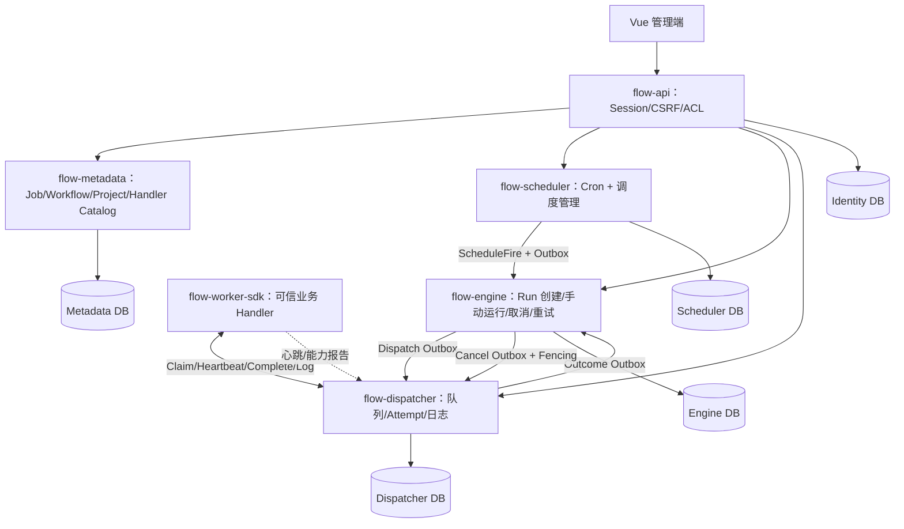
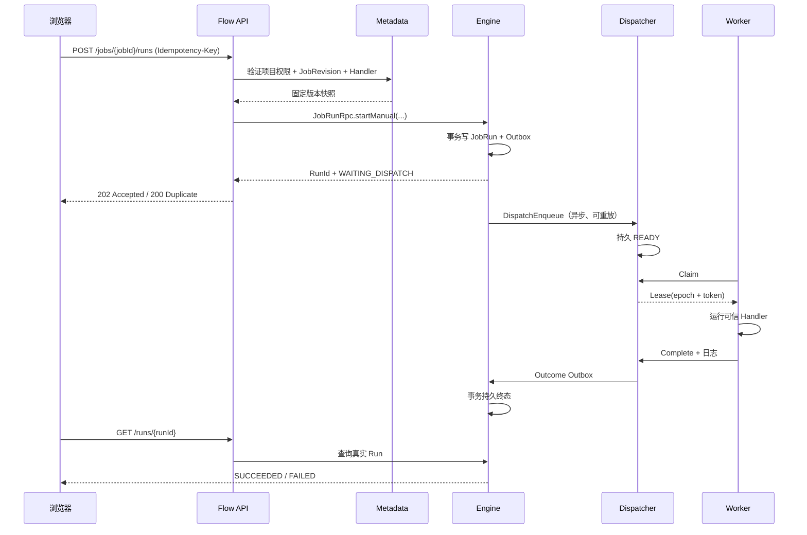
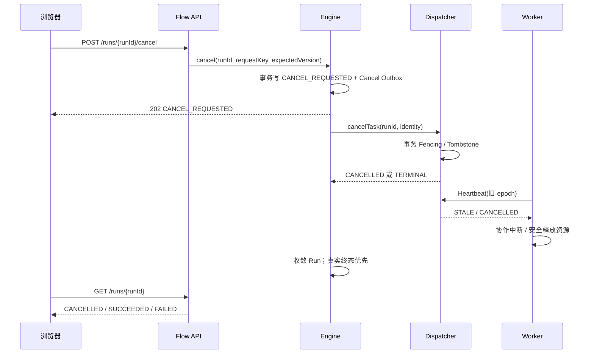
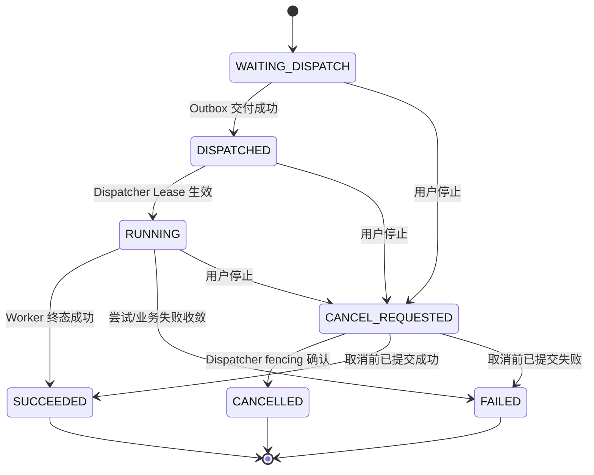

# OTRYX Flow 1.0：可实际使用的分布式任务调度平台实施方案

> 文档类型：需求基线 + 技术实施方案 + 开发任务清单 + 验收规范  
> 版本：v1.0（规划稿，**不代表相关功能已经完成**）  
> 编制日期：2026-11-03  
> 项目：[Ryan-Guizhou/otryx-flow](https://github.com/Ryan-Guizhou/otryx-flow)  
> 源码审计基线：`main@396fafed151612d486a1bb43c3e5b9ea17d079de84`  
> 目标：**让用户真正能够登录、退出、创建任务、立即执行、停止执行、暂停/恢复/修改 Cron、查询日志和历史，并运行真实业务 Handler，而不是仅用于演示的 Demo。**

---

## 0. 总体结论与交付原则

目前仓库已经存在 Spring Security Session 登录、项目与 Job 草稿/发布、Cron 调度、Scheduler/Engine/Dispatcher 持久交付、Worker SDK、DAG 与局部取消/日志能力；但**普通 Job 的立即执行、停止、人工重试、完整执行详情与可执行 Handler 管理尚未形成完整产品闭环**。已有功能也存在跨模块领域契约和容量控制不一致问题。

本次不以 PR 关闭、前端页面存在或单元测试数量作为完成依据，而以「**真实浏览器操作 → REST → OTRYX RPC → 数据库 → Worker → 持久化结果 → 浏览器显示**」的端到端结果作为准入标准。

**交付策略**：

1. **P0：先实现任务调度平台的最小完整业务闭环**（登录退出、Job CRUD、立即执行、取消、Cron、日志、历史、真实 Handler）。
2. **P0：同步解决会造成误执行、无法停止、越权、重复执行和排队任务失败的正确性问题**。
3. **P1：完善 Worker、用户/项目管理、失败重试、审计和运维体验**。
4. **P2：再做 DAG 数据流、高级治理、压测和正式安全生产化**。指标与 CI 不得挤占 P0 主链路开发；但必要的测试/门禁不能省略。
5. **不推倒现有微服务边界**：保留 `flow-api`、`flow-metadata`、`flow-scheduler`、`flow-engine`、`flow-dispatcher`、`flow-worker-sdk`、`flow-web`，只做有明确目的的契约补全与数据库迁移。

### 0.1 1.0 Definition of Done（发布阻断条件）

仅当以下全部成立，才允许标记 **1.0 功能可用**：

- [ ] 从干净 MySQL/Nacos 开始，按项目脚本一键部署，所有关键服务健康。
- [ ] 用户可使用真实数据库账号登录，刷新页面后会话仍有效，退出立即失效。
- [ ] 用户可以通过管理界面创建项目、创建 Job、修改参数、发布版本。
- [ ] 用户选择已注册且在线的业务 Handler，点击 **立即执行**，数据库实际生成 Run/Task，Worker 确实执行，最终显示 `SUCCEEDED`/`FAILED`，不是固定模拟结果。
- [ ] 用户可对 `READY` 和 `LEASED` 实例点击 **停止**，状态遵循取消协议；停止后不再产生新的该实例业务执行。
- [ ] 用户可创建、编辑、暂停、恢复 Cron 计划；暂停仅影响未来触发，已运行任务不被误杀。
- [ ] 用户可查看普通 Job 和 DAG 的历史、实际尝试、运行日志、失败原因和耗时。
- [ ] 用户可对失败实例点击 **重新执行**，原历史不可被覆盖。
- [ ] 多副本并发、Outbox ACK 丢失、Worker 崩溃、重启恢复、权限隔离和配额边界有实际测试结果。
- [ ] 前端页面和 API 返回真实数据；不得出现“看起来完成、底层未接通”的占位功能。
- [ ] 文档与 UI 反映当前支持情况；正式发布说明明确区分**受控内网部署**与**公网/生产安全部署**。

> 安全边界：当前代码使用 Nacos + `TRUSTED_DEVELOPMENT`，生产 `NETWORK_MTLS` 尚有阻塞。**1.0 功能可用不等同于公网生产就绪；不得将当前开发配置直接暴露公网。**

---

## 1. 基于当前完整源码的能力基线

状态定义：`CURRENT`=代码已有主链路；`PARTIAL`=部分实现；`GAP`=缺失；`RISK`=源码显示有正确性风险；`PROPOSED`=本文件拟新增方案。

| 能力 | 当前状态 | 对应源码或具体事实 | 1.0 交付要求 |
| --- | --- | --- | --- |
| Session 登录/退出 | CURRENT | `flow-api/.../auth/AuthController.java`；`flow-web/src/api.ts` | 补全异常、会话失效、跨页面体验及真实 E2E |
| CSRF / BCrypt / 管理员初始化 | CURRENT | `FlowSecurityConfiguration`、`FlowBootstrapAdmin` | 保留并验证，禁用不安全默认设置 |
| 用户管理/修改密码 | GAP | 现有用户表仅含用户名、密码哈希、角色、启用位 | 增加密码修改与管理员基本管理 |
| 项目创建/查询 | CURRENT | `ProjectRpcService`、`ProjectController` | 完善项目权限与前端实际数据 |
| Job 草稿/发布 | CURRENT | `JobRpcService`、`JobController` | 增加编辑 UI、归档、Handler 选择 |
| **Job 立即执行** | **GAP** | `EngineRpc.acceptScheduledFire` 只接受 `origin=CRON` | 新增 MANUAL Run 创建与幂等键 |
| **普通 Job 停止** | **GAP** | 当前 Dispatcher 仅 `cancelDagTask` | 通用单 Run 取消 + 持久取消 Outbox |
| **普通 Job 手动重试** | **GAP** | 普通 Job 无重试控制 API | 新 Run/新逻辑尝试，不覆盖旧记录 |
| Cron 创建/暂停/恢复 | CURRENT | `ScheduleRpcService.create/toggle` | 加强前端，补充更新与归档 |
| Cron 编辑/删除 | GAP | `ScheduleRpc` 无更新/归档方法 | CAS 修改、逻辑归档与历史保留 |
| Scheduler 多副本/Outbox | CURRENT | `ScheduleScanner`、`ScheduleOutboxRelay` | 保留，补故障场景测试 |
| Dispatcher Lease/Fencing | CURRENT | `DispatcherRpcService`、`WorkerRuntime` | 复用并补停止语义 |
| 普通 Job 日志详情 | PARTIAL | Dispatcher 已有 `queryLogs`；REST 主要面向 DAG | 普通 Run 独立详情、日志和 Attempt |
| DAG 条件/并行/取消/重试 | CURRENT（核心） | `DagRunRpcService` 等 | 稳定现有能力，不阻塞普通 Job P0 |
| Cron 触发 DAG | GAP | Schedule 仅绑定 JobRevision | 1.0 后续批次统一调度目标 |
| Worker Handler 能力目录 | GAP | Worker 本地允许表；Workflow 只放行 `safe.echo`/`safe.fail` | 统一业务 Handler Catalog 与可用性 |
| 项目配额 | RISK | `AdmissionGate.rejectEnqueue` 计数后插入 | 原子校验、容量重试与公平队列 |
| Worker Drain | PARTIAL | `AdmissionGate.drain` | 连接 Worker 在线状态与实际停领反馈 |
| 管理首页实际统计 | PARTIAL | `App.vue` 仍有 M1/M2 里程碑占位 | 以实际 API 聚合结果替换 |
| 安全生产部署 | GAP | `ProductionProfileGuard` 拒绝 `NETWORK_MTLS` | 另立生产安全门禁，不偷换为开发模式 |

### 1.1 必须纠正的跨模块不一致

1. **调度目标不统一**：Cron 仅 Job，DAG 只可手动；`ScheduleCreateCommand`、`EngineRpc`、`DagRpc` 分开定义。
2. **Handler 不统一**：REST 允许 `safe.*`，Metadata 普通 Job 接受更宽的标识，DAG 定义和 Engine 硬编码 `safe.echo/safe.fail`，Worker 根据实际注册表执行。
3. **容量不足混淆为派发失败**：Dispatcher `CAPACITY_REJECTED` 被 DAG Relay 当作一般重试，达到其重试预算后可能判定为最终失败。
4. **并发语义冲突**：DAG 在 Dispatcher 兼容字段中复用 `workflowId` 作为 `jobId`，按 Job 维度的 `FORBID` 规则会阻挡合法 DAG 并行节点。
5. **授权来源不唯一**：Metadata 持有项目所有权，Dispatcher 配额表又维护独立 Owner，必须消除可以创建/读取任意项目配额的机会。
6. **运行历史分裂**：普通 Job 和 DAG 各自有 Run 模型和 UI；1.0 应提供统一执行中心视图，同时保留各自持久化逻辑。

---

## 2. 1.0 产品功能需求（P0）

### 2.1 用户与登录退出

**用户故事**：管理员启动服务并创建真实账号；用户在登录页输入用户名/密码，进入自己的项目；退出后无法访问受保护页面或 API。

必须实现：

- 登录：用户名密码校验，统一错误信息；失败不创建已认证 Session；防止账号枚举。
- 登录态：浏览器刷新、切换路由和重新打开应用时，通过 `/api/v1/auth/me` 恢复状态；403/401 有明确区别。
- 退出：`POST /api/v1/auth/logout` 使服务端 Session 失效；前端清理缓存、状态与页面；退出后直接访问 API 返回 401。
- 密码：首次启动凭据从环境变量/Secret 提供，不写在前端；支持用户修改密码、管理员重置、禁用账号；变更后按策略使旧 Session 失效。
- 安全：保留 BCrypt、CSRF、HttpOnly、SameSite、生产 HTTPS Secure Cookie；登录限速/失败锁定策略可配置，所有敏感操作记录审计。
- 权限：1.0 最小角色 `ADMIN`/`OPERATOR`/`VIEWER`，角色与项目成员关系应在**同一可信授权服务**核验；不允许通过请求正文伪造 `ownerUsername`。
- 开发内网可使用 Bootstrap Admin；生产配置必须设置强随机密码并关闭自动 Demo 客户端。

**UI 要求**：登录界面、用户菜单、退出确认、修改密码页面、会话过期提示；登录后不能展示仅服务于开发的“Coming next”占位。

**验收**：正确密码登录，错误密码 401，刷新保留登录态，普通账号无法访问管理员接口，退出后 `/me` 为 401；浏览器 E2E 真实执行。

### 2.2 任务（Job）管理

- 新增 Job：名称、所属项目、Handler Key、参数 JSON、超时、重试次数、执行策略。
- 编辑草稿：前端完整编辑表单、客户端校验与服务端校验、乐观锁冲突提示。
- 发布版本：只能执行已发布 `JobRevision`，发布快照不可变。
- 启用/停用 Job：停用后不能再新建实例，已有实例按运行控制策略收敛（需区别 Cron 暂停）。
- 归档：默认列表隐藏归档定义，但历史 Run/日志仍可查询；有关联 Schedule 时要求先停用或关联处理。
- **Handler 必须真实可执行**：发布或执行前验证 Handler Catalog 已注册、当前拥有至少一台适用 Worker（是否必须在线可单独设策略），否则明确提示 `HANDLER_UNAVAILABLE`，而不是“执行成功”或一直积压。
- 版本与引用：Cron / 手动 Run 指定的版本不会因为后续修改草稿而变化。

### 2.3 立即执行（最高优先级）

**操作**：任务列表点击“立即执行”，可选择当前已发布 Revision，允许一次性覆盖已授权的有限参数，确认后获得 Run ID，自动跳转执行详情。

要求：

- 不创建临时 Cron；**直接由 Engine 创建一次 MANUAL Job Run**。
- 必须发送 `Idempotency-Key`；重复提交返回相同 Run，正文变动返回 409。
- Engine 校验 JobRevision 所有权与 Handler，使用本地事务创建 Run + Engine Outbox；异步派发给 Dispatcher。
- 返回创建/已存在语义，**不能以 HTTP 创建成功代表任务执行成功**。
- 用户看到 `WAITING_DISPATCH -> DISPATCHED -> RUNNING/LEASED -> SUCCEEDED/FAILED` 的真实状态；执行过程中可刷新。
- 支持 `maxQueued`，容量不足时进入明确的等待状态或返回可解释的容量拒绝；**容量不足不能直接等价于业务失败**。

### 2.4 停止执行（最高优先级）

**操作**：执行列表/详情点击“停止本次执行”。

语义：

- `WAITING_DISPATCH`：先持久化取消意图，阻止未来 Outbox 派发。
- `READY`：Dispatcher 标记 `CANCELLED`，阻止领取。
- `LEASED`：Dispatcher 通过 CAS Fencing 当前 Lease，Worker 在下一次心跳或协作取消检查后感知；返回 `CANCEL_REQUESTED` 直到完成收敛。
- `SUCCEEDED/FAILED/CANCELLED`：不可被后来取消请求倒写；返回终态或相应冲突结果。
- 客户端重试使用同一 `Idempotency-Key` 和可选期望 `runVersion`；不能因丢失 ACK 发起第二次不同业务操作。
- 需要通用 `cancelTask` RPC，不再让普通 Job 借用只针对 DAG 身份结构的 `cancelDagTask`。
- 停止不是 JVM 强杀；不能回滚已发生的业务副作用。API/UI 必须诚实展示取消意图与已完成取消两个阶段。

**补充**：Cron 的“暂停调度”不会取消已存在 Run；提供显式“暂停调度并停止指定运行实例”组合入口，但采用分别持久化、可重试的两个操作。

### 2.5 Cron 调度管理

- 新建：已发布 Job Revision、六字段 Cron、IANA 时区、Misfire 策略。
- 预览：展示未来 N 次触发的本地时间/UTC/时区偏移。
- 编辑：CAS 修改表达式、时区、策略及绑定 Revision；维护版本、游标变更和审计，不更改已经产生的 Trigger。
- 暂停/恢复：暂停后不生成新 Trigger；恢复时从当前时间重新计算下一次触发，Misfire 按明确策略处理。
- 删除：建议逻辑归档、保留已产生的 Trigger 和运行记录。
- 手动触发：定时任务页面也能选择“立即执行一次”，行为与 Job 立即执行一致，不额外制造 Cron 火点。
- 执行历史：可以从 Schedule 看到所有由其触发的 Run，便于定位问题。

### 2.6 执行中心与日志

**统一导航**：“执行中心”以 Job Run 和 DAG Run 分类展示，但不强制合并底层不同的业务表。

- 查询条件：项目、任务、来源（CRON/MANUAL/RETRY）、状态、时间范围、Worker、执行人。
- 展示：Run ID、Job、Revision、触发来源、计划时间、创建时间、开始/结束时间、耗时、状态、重试次数、Worker ID。
- 详情：逻辑 Run、Dispatcher Task、各个物理 Attempt、最后失败原因、日志与状态变化时间线。
- 日志：普通 Job 也支持分页查看 Worker 真实日志，并有有界保留/脱敏；支持刷新，不伪装为实时推送。
- 操作：停止、重试、跳转 Job、跳转 Schedule、复制 Run ID。
- 一致性：显示的成功/失败来自 Engine/Dispatcher 持久化结果，不能用 RPC ACK 或前端 Timer 推测。

### 2.7 Worker 与业务 Handler

- **真实业务扩展**：保留 `WorkerHandler`/`WorkerRuntime`，支持开发者实现可信 Java Handler 并注册到 Worker；不要求任意 Shell/Python 执行。
- Handler Catalog：维护 Handler Key、版本、参数 JSON Schema、超时/取消支持、标签、启用状态；合法性由 Metadata 统一定义，Worker 注册实时上报能力。
- Worker 信息：Worker ID、支持的 Handler、最后心跳、状态、并发上限/占用 Slot、Drain、最后错误。
- Worker 管理：Drain/恢复领取（需要明确管理员操作与租约行为），可观察实例是否在线。
- 一致性：Job 定义的 Handler 必须与实际 Worker 能执行的 Handler Key 一致，不能仅依赖 `safe.*` 文本前缀。
- 取消契约：Handler 应定期调用 `context.checkCancelled()`；不协作的业务 Handler 应有执行超时与风险提示。

---

## 3. 推荐架构：在现有微服务上补齐控制面



**架构约束**：各服务只写各自 Schema；跨服务通过 OTRYX RPC；RPC 不得包裹在需要长期持有行锁的数据库事务中；以事务 Outbox/Inbox 处理丢失 ACK；不得要求五个 Schema 的单个全局事务。

### 3.1 明确区分五个领域对象

| 概念 | 职责 | 关键 ID |
| --- | --- | --- |
| `JobDefinition` / `JobRevision` | 任务是什么、哪个 Handler、参数与重试策略 | `jobId`, `revision` |
| `ScheduleDefinition` | 何时触发，Cron / 时区 / Misfire | `scheduleId`, `scheduleRevision` |
| `JobRun` | **一次逻辑执行**，来源可以是 CRON、MANUAL、RETRY | `runId` |
| `DispatchTask` / `Attempt` | Worker 领取和执行的物理尝试 | `taskId`, `leaseEpoch` |
| `WorkflowRevision` / `DagRun` / `NodeRun` | 复杂工作流的图结构、父运行和节点运行 | `workflowId`, `dagRunId`, `nodeRunId` |

不要将 DAG 的 `workflowId` 长期伪装成普通 Job 的 `jobId`，否则会污染配额、禁止并发及审计语义。

### 3.2 立即执行调用顺序



### 3.3 取消执行调用顺序



**关键条件**：取消意图可持续重试；Dispatcher 支持“先取消后入队”的持久 Tombstone；已成功提交的终态不得被迟到取消覆盖。

---

## 4. 建议的状态机与业务控制规则

### 4.1 Job Run 状态（Proposed）



现有普通 Job `flow_workflow_run` 只有 `WAITING_DISPATCH / DISPATCHED / SUCCEEDED / FAILED` 等状态；图中 `RUNNING`、`CANCEL_REQUESTED`、`CANCELLED` 是**拟新增的 Run 控制语义**。真实显示需与 Dispatcher Task 的 `READY/LEASED` 对账；可以增加 `control_state` 字段防止将“执行结果状态”与“取消意图”混为一个枚举。

### 4.2 行为矩阵

| 当前状态 | 立即执行 | 暂停 Cron | 停止本次执行 | 重试 |
| --- | --- | --- | --- | --- |
| 未发布 Job | 不允许 | 不适用 | 不适用 | 不适用 |
| 已发布 Job | 允许创建新 Run | 可暂停其关联 Schedule | 需指定 Run | 不适用 |
| WAITING_DISPATCH | 允许新独立 Run | 不影响当前 Run | 允许 | 不允许 |
| READY / DISPATCHED | 允许新独立 Run（服从策略） | 不影响当前 Run | 允许 | 不允许 |
| LEASED / RUNNING | 允许新独立 Run（服从策略） | 不影响当前 Run | 允许协作取消 | 不允许 |
| CANCEL_REQUESTED | 不影响其他 Run | 不影响当前 Run | 使用相同键重试控制请求 | 不允许 |
| SUCCEEDED | 允许新独立 Run | 不适用 | 不修改终态 | 可选择“重新执行为新 Run” |
| FAILED | 允许新独立 Run | 不适用 | 不修改终态 | 允许新 Run，保留旧失败 |
| CANCELLED | 允许新独立 Run | 不适用 | 幂等返回已取消 | 允许重新执行为新 Run |

### 4.3 幂等与异常码（Proposed）

- `201/202`：创建或接受控制指令，返回 Run/控制状态，不代表业务已经成功。
- `200`：使用同一 Idempotency-Key 的完全相同请求重放，返回原结果。
- `400`：参数校验失败；`401`：未登录；`403`：无权限；`404`：资源不存在或对该用户不可见。
- `409`：版本 CAS 冲突、同幂等键不同请求、不能转换的终态。
- `429` 或明确业务错误码：容量不足，必须区分“排队等待”和“永久拒绝”，避免被 Engine 误判成业务失败。
- `503`：依赖服务不可用；返回时应保留已持久化操作的幂等恢复能力。

---

## 5. REST API 新增/调整清单（全部为 Proposed，**不是现有可调用接口**）

现有接口继续保留；以下仅为建议的 1.0 契约，实施时需同步生成/校验 TypeScript Client。

| 方法 | 接口 | 用途 | 核心要求 |
| --- | --- | --- | --- |
| `POST` | `/api/v1/auth/change-password` | 修改自己的密码 | 校验旧密码，哈希更新，失效旧 Session |
| `GET` | `/api/v1/projects/{projectId}/jobs/{jobId}` | Job 详情 | 真实归属校验 |
| `PUT` | `/api/v1/projects/{projectId}/jobs/{jobId}/draft` | 编辑草稿 | **已有**，完善 UI |
| `POST` | `/api/v1/projects/{projectId}/jobs/{jobId}/archive` | 归档任务 | 不删除历史 |
| `POST` | `/api/v1/projects/{projectId}/jobs/{jobId}/runs` | **立即执行** | 固定 Revision + Idempotency-Key |
| `GET` | `/api/v1/projects/{projectId}/runs` | 普通 Job Run 列表 | 后端过滤、分页 |
| `GET` | `/api/v1/projects/{projectId}/runs/{runId}` | 执行详情 | Run+Task+Attempt+错误 |
| `POST` | `/api/v1/projects/{projectId}/runs/{runId}/cancel` | **停止本次执行** | 幂等键 + CAS；可返回 202 |
| `POST` | `/api/v1/projects/{projectId}/runs/{runId}/retry` | 重新执行 | 新 RunId、指向原 Run 的关联 |
| `GET` | `/api/v1/projects/{projectId}/runs/{runId}/logs` | 普通任务日志 | Dispatcher 有界日志、游标分页 |
| `PUT` | `/api/v1/projects/{projectId}/schedules/{scheduleId}` | 修改 Cron | expectedVersion + 原子更新 |
| `POST` | `/api/v1/projects/{projectId}/schedules/{scheduleId}/enabled` | 暂停/恢复 Cron | **已有**，保留并完善 UI |
| `POST` | `/api/v1/projects/{projectId}/schedules/{scheduleId}/archive` | 归档计划 | 不影响历史触发 |
| `POST` | `/api/v1/projects/{projectId}/schedules/{scheduleId}/run-now` | 定时任务立即执行一次 | 走同一 MANUAL Run，不伪造 Cron Trigger |
| `GET` | `/api/v1/handlers` | Handler Catalog | 注册版本、参数 Schema、可用 Worker 数量 |
| `GET` | `/api/v1/workers` | Worker 在线清单 | 心跳、Slots、Handlers、Drain 状态 |
| `GET` | `/api/v1/overview` | 首页真实统计 | 不能使用里程碑占位 |

现有接口以仓库中实际注解为准，例如 `/api/v1/auth/login`、`/api/v1/auth/logout`、`/api/v1/auth/me`、`/api/v1/projects/{projectId}/jobs`、`/api/v1/projects/{projectId}/schedules`、`.../enabled`。

### 5.1 建议的请求/响应示例（设计稿）

```http
POST /api/v1/projects/{projectId}/jobs/{jobId}/runs
Content-Type: application/json
Idempotency-Key: 35e17c6a-9d40-4826-89c1-c67e46e4fb88
X-XSRF-TOKEN: <session-csrf-token>

{
  "jobRevision": 3,
  "parameterOverrides": {},
  "triggerSource": "MANUAL"
}
```

```json
{
  "runId": "<generated-run-uuid>",
  "jobId": "<job-uuid>",
  "jobRevision": 3,
  "triggerSource": "MANUAL",
  "status": "WAITING_DISPATCH",
  "createdAt": "<utc-time>"
}
```

```http
POST /api/v1/projects/{projectId}/runs/{runId}/cancel
Content-Type: application/json
Idempotency-Key: 24069c2c-79a5-43fb-ad3e-e6a8279c9b12
X-XSRF-TOKEN: <session-csrf-token>

{"expectedRunVersion": 5}
```

```json
{
  "runId": "<run-uuid>",
  "status": "CANCEL_REQUESTED",
  "accepted": true
}
```

以上字段/路由为拟新增契约；交付时须与最终 RPC、Flyway 和前端定义同步。

---

## 6. RPC 契约与代码改动建议

### 6.1 `flow-contracts`

拟新增：

- `JobRunRpc.startManual(StartManualJobRunCommand)`：稳定幂等键、固定 Job Revision、参数快照、真实 Owner。
- `JobRunRpc.detail/list`：执行详情、Attempt 摘要与分页。
- `JobRunControlRpc.cancel/retry`：Run 控制与状态确认。
- `DispatcherRpc.cancelTask(DispatchTaskCancelCommand)`：统一物理 Task 取消，正确处理“先取消后入队”和当前 Lease Fencing。
- `HandlerCatalogRpc` 或经现有 Metadata RPC 扩展：受信任 Handler 清单及声明版本。
- 统一响应码枚举/常量：`CREATED`, `DUPLICATE`, `CAPACITY_WAIT`, `CAPACITY_REJECTED`, `CONFLICT`, `CANCEL_REQUESTED`, `CANCELLED`, `TERMINAL` 等；区分 transient/permanent。

**兼容要求**：保留原 `EngineRpc.acceptScheduledFire` 和 `DagRpc` 方法签名，不做无迁移的破坏性替换；新增 RPC 方法先双边可用，再切换调用者。

### 6.2 `flow-engine`

- 新增手动 Run 创建服务，复用已存在的普通 Job Run/Dispatch Outbox 可靠模式。
- **不得把 MANUAL 请求伪装成 `ScheduleFireCommand(origin=CRON)`**：当前 `EngineRpcService.validate` 明确拒绝非 CRON。
- 引入通用 Run 取消状态与持久化 Cancel Outbox；在 `EngineDispatchRelay` 派发前检查取消意图；与 Dispatcher Cancel Tombstone 竞争时保证最终一致。
- 增加 Run Version CAS、`request_key`/请求指纹、创建来源、重试关联、状态时间线。
- `acknowledgeTaskOutcome` 需要支持取消-终态竞态；所有逻辑终态不可逆。
- 普通 Run 详情可通过 Engine 汇总自身状态与 Dispatcher Task/Attempt，只在事务外跨服务查询。
- 容量控制不能让暂时缺少 Worker Slot 的 Run 自动走入最终 FAILED；需可持续重试或由用户明确取消。

### 6.3 `flow-dispatcher`

- 泛化 `cancelDagTask` 所使用的 Fencing/Tombstone 为通用 Task Cancel，保留原 DAG 入口作兼容封装，统一身份字段。
- 在 `claim` 的候选选择中避免前 8 个被满额项目占据导致其他项目饥饿。
- 配额校验必须在跨 Dispatcher 并发下**原子**：按 `project_id` 锁定现有配额行，或采用独立项目计数/预留表及版本 CAS；所有入队和领取路径遵循同一事务协议。
- `FORBID` 以逻辑 Job Run 的并发规则为准，不能误把同一 DAG 的多个合法 NodeRun 当成重复执行。
- 增加 Worker 注册/心跳目录，支持过期判定和 Handler/Slot 视图；这些是能力数据，不能由 Drain 表伪造在线状态。
- 任务历史/日志清理使用短事务批量删除、合理索引，不能因长保留期项目占据扫描窗口而无限饥饿。

### 6.4 `flow-metadata`

- 统一可信项目授权来源，并提供面向 API/业务服务的 `assertProjectAccess` 或等效验证。
- 新增 Job 启用/归档状态与必要的审计字段。
- 统一 Handler Catalog（明确静态受信任注册与动态 Worker 能力的区别）；移除普通 Job 与 DAG 之间相互冲突的硬编码允许范围，保留代码执行的安全边界。
- 执行前校验已发布 Revision，并保证跨服务 RPC 在当前服务事务之外进行。

### 6.5 `flow-worker-sdk` 与 `flow-worker-quickstart`

- 保留 `WorkerHandler.execute(String, WorkerContext)`，1.0 先确保 Handler 能真正执行、有取消检查、有日志，不强制把 void 返回值改成复杂输出接口。
- 增加 Worker 注册/状态心跳，声明 Handler Key、版本、最大并发、已占 Slot。
- 统一 `leaseExpired`、`CANCELLED`、`STALE` 和可重试 RPC 不确定结果的处理。
- 自带**一个可验证的真实示例业务 Handler**，如数据汇总/数据库记录转换，必须实际产出可检查的业务结果，不能只使用 `safe.echo` 成功断言。
- 后续 1.1 再引入有界节点输出/对象存储引用、跨节点结果传递和更复杂的执行隔离。

### 6.6 `flow-api` 与 `flow-web`

- API 只从登录上下文提取身份，任何跨 RPC 管理操作均验证项目权限；前端按钮不作为权限边界。
- 错误码与 HTTP 状态统一映射，401 自动清除前端用户状态，403 展示权限不足，409 提示版本/幂等冲突。
- 增加任务详情、编辑、立即执行、停止、重试、执行历史与日志入口。
- Cron 列表支持编辑/暂停/恢复/立即执行；停止 Run 与暂停 Cron 使用不同按钮与说明。
- 替换首页所有“Coming next”和 M1 里程碑统计占位；数据通过真实服务查询。
- 切换项目时重置上一个项目的列表、详情和日志，避免跨项目 UI 残留。
- 对执行状态采用后端轮询（可见页面每 2–5 秒；后续才加 SSE/WebSocket），只呈现服务端持久状态。

---

## 7. Flyway 数据库迁移设计（Proposed）

现有生产代码不能直接删除或重建已有表；以下为**拟新增迁移及字段**，实施前需检查各模块实际最高 Flyway 版本和与最新分支的一致性。

### 7.1 Engine：普通 Job Run 扩展

建议新增 `flow-engine/src/main/resources/db/migration/V6__job_run_control.sql`，可选择**兼容扩展现有** `flow_workflow_run`，而非立即新建并行的第二套普通 Job Run 表：

- `trigger_source`：`CRON | MANUAL | RETRY`（现有 `origin` 可在保留兼容的前提下升级使用）。
- `schedule_id / schedule_revision / planned_fire_at_utc` 对非 CRON 运行允许空值，或使用独立 source 明细表；**不得造一个假 UUID 冒充真实 Schedule**。
- `request_key`、`request_fingerprint`：手动执行幂等；建议独立 `flow_job_run_request` 表，以 `(owner_username, request_key)` 唯一保证重放。
- `run_version`、`control_state`、`cancel_requested_at`、`started_at`、`finished_at`、`failure_code`、`retry_of_run_id`。
- 通用取消 Outbox：`flow_engine_run_cancel_outbox(run_id, event_id, delivery_state, claim_token, lease_until, attempts, next_attempt_at, last_error, ...)`。
- 为 `project_id, created_at`、`job_id, created_at`、`status, created_at` 增加实际查询需要的索引。
- 旧 Run 数据迁移保留原状态与索引；旧 cron 火点 Inbox/唯一逻辑 Fire 约束必须继续生效。

> 重要：MySQL `UNIQUE` 在包含 `NULL` 时不会自动提供“每用户同请求键”的完整幂等保障。因此不能仅依赖原来的 `(schedule_id, schedule_revision, planned_fire_at_utc, origin)` 唯一约束支持 MANUAL。

### 7.2 Dispatcher：通用 Cancel + Worker 信息 + 原子配额

建议新增 `flow-dispatcher/.../db/migration/V5__task_control_and_worker_directory.sql`：

- 任务执行身份：`target_type`、`target_id`、`logical_run_id`（如需保留旧字段，提供兼容读取），避免 DAG 跨字段借名。
- Worker 状态目录：`flow_worker_registration(worker_id, heartbeat_at, status, capacity, occupied, handlers_json, version, ...)`，配合 TTL/过期视图。
- 项目配额原子行锁/计数预留机制，必要时补 `flow_project_admission` 缺失行的安全初始化机制。
- 支持高频配额查询和 Terminal Retention 的复合索引。
- 原 `flow_dispatch_task`、`flow_dispatch_attempt`、Outbox/日志表的数据保持可读可迁移。

### 7.3 Metadata / API

- Metadata 新增 Job 归档状态、Handler Catalog、项目访问授权映射；保留不可变 Revision。
- API 身份库新增密码修改时间、账号锁定/失败统计和管理审计所需字段，禁止将密码、密钥和 Session 存入业务日志。
- 所有 DDL 必须使用新 Flyway 版本、前向兼容、可回滚方案或事先确定的恢复策略，禁止直接改旧 `V1..V5` 迁移文件。

---

## 8. 开发阶段、依赖与可并行任务

以下阶段按**业务闭环**切分。可以多开发者并行修改代码，但必须以同一契约基线联调，禁止每人独立定义同名状态/返回码。

| 阶段 | 优先级 | 关键交付 | 依赖 | 阶段退出条件 |
| --- | --- | --- | --- | --- |
| **F0：统一契约与修基础问题** | P0 | Run/Cancel/Handler/ACL 标准、配额返回码与安全模型 | 当前源码 | 契约测试+原子配额测试通过 |
| **F1：登录、会话与任务管理** | P0 | 登录退出可靠、密码修改、任务编辑与归档、Handler 选择 | F0 的 ACL/Handler 定义 | 浏览器真实登录→创建 Job→发布通过 |
| **F2：普通 Job 立即执行** | P0 | Run RPC、Flyway、Engine Outbox、REST、按钮 | F0 + F1 JobRevision | 点击立即执行可观察 Worker 真实执行至终态 |
| **F3：普通 Job 停止与重试** | P0 | 通用 Cancel RPC、取消 Outbox、Tombstone、重试 | F2 | READY/LEASED 停止均最终收敛，不倒写终态 |
| **F4：Cron 完整管理** | P0 | 编辑/归档/暂停/恢复/Run Now | F2 + Scheduler | UI 可配置并验证真实定时执行 |
| **F5：执行中心与 Worker** | P0/P1 | 历史/日志/Attempt/在线注册/首页统计 | F2/F3 | 所有数据来自真实持久状态 |
| **F6：全链路验收** | P0 | Compose + Playwright + 并发/故障/权限测试 | F0–F5 | 完成 1.0 验收清单，形成可复现报告 |
| **F7：生产安全与正式发行** | P1/P2 | Nacos mTLS、发布镜像、HTTPS、备份恢复指标 | 上游 RPC 修复 | 经安全和运行门禁后独立发布 |

### 8.1 建议的团队工作流

- **契约负责人**：负责一次性定义 `flow-contracts` 中 Run/Cancel/状态/错误码和兼容策略。
- **后端执行负责人**：Engine + Dispatcher + Worker，负责 F2/F3 的完整执行闭环。
- **调度与元数据负责人**：Metadata + Scheduler，负责版本、Handler、Cron 修改、ACL。
- **前端负责人**：Vue 实际管理交互及 Browser E2E，不能使用 Mock API 代替交付。
- **联调负责人**：数据库迁移、真实 Compose、故障注入、验收数据与发布清单。

以一个**集成里程碑**为最小交付单位：开发期间允许按文件/模块并行提交，所有功能联调完成后统一运行 CI，减少无意义重复构建；合并 `main` 以有证据的阶段完成为准。不能因为减少 CI 而跳过最终质量门禁。

---

## 9. 核心验收测试用例（必须自动化 + 人工 UI 抽查）

| ID | 场景 | 步骤 | 通过条件 |
| --- | --- | --- | --- |
| AT-01 | 登录/退出 | 用数据库账号登录、刷新、退出、再访问 `/me` | 成功登录，刷新仍有效，退出后 401 |
| AT-02 | 错误凭据 | 使用无效密码与禁用用户登录 | 都不可创建认证会话 |
| AT-03 | CSRF/权限 | 无 CSRF POST，Viewer 修改 Job，非所有者访问其他项目 | 403/拒绝，无越权数据泄露 |
| AT-04 | 创建与发布 | UI 创建 Job、修改、发布 r1，再修改发布 r2 | r1 不变、r2 独立存在 |
| AT-05 | **立即执行** | UI 运行已发布 Job r1 | 产生一个持久 Run，Worker 真正执行，结果可查 |
| AT-06 | 立即执行幂等 | 使用相同 Key 重放及修改正文重放 | 同请求同 Run，不同请求 409 |
| AT-07 | 手动执行和 Cron 独立 | Job 有 Cron 时点击 Run Now | 不制造虚假 Cron Fire，手动和 Cron 均可查询 |
| AT-08 | READY 停止 | 没有可用 Worker 时创建 Run，立即停止 | 队列不可再领取，最终取消 |
| AT-09 | LEASED 停止 | 可协作中断 Handler 正在运行时停止 | Fencing 失效、最终取消或合法终态，不伪报强杀 |
| AT-10 | 停止竞态 | Worker 成功提交与用户取消同时发生 | 终态不可倒退、取消幂等 |
| AT-11 | 失败重试 | 故意触发失败，再点击重试 | 新 Run，新历史，原失败记录保留 |
| AT-12 | Cron 暂停/恢复 | 设置秒/分钟可验证 Cron，暂停、等待、恢复 | 暂停期不产生新 Trigger，恢复后按策略执行 |
| AT-13 | Cron 编辑 | CAS 更新 Cron、时区与版本 | 新计划使用新配置，旧 Trigger 不变 |
| AT-14 | 服务重启恢复 | 派发或停止的 Outbox 处于半途时重启 Engine/Dispatcher | 自动继续，不重复生成不同逻辑 Run |
| AT-15 | Worker 断联 | Worker Claim 后强制终止，等待租约过期 | 其他 Worker 可恢复，旧代际无权回写 |
| AT-16 | 容量原子性 | 双 Dispatcher 竞争最后一个项目额度 | 配额不超限、不发生越界入队 |
| AT-17 | 容量退避 | 项目满载，稍后释放额度 | Run 正常等待并继续，不误判 FAILED |
| AT-18 | 多项目公平性 | A 项目积压超额，B 项目可调度 | B 仍能在合理时间内获得执行机会 |
| AT-19 | Handler 能力 | 发布未注册 Handler、停掉某类 Worker | 明确拒绝或等待策略，不出现虚假执行成功 |
| AT-20 | 执行详情 | UI 查看 Job Run、Attempt、Worker、日志、失败信息 | 全部来自真实数据库/服务 |
| AT-21 | 旧 DAG 回归 | 运行并行/条件/汇聚/取消/重试用例 | 与新增普通 Job 控制互不破坏 |
| AT-22 | 清理恢复 | 人为制造长期数据，触发 Retention 并模拟中断 | 不删除未投递结果，故障可恢复，项目间无饥饿 |
| AT-23 | 真实浏览器 E2E | Playwright 通过真实 API/Compose 完成登录→建任务→立即执行→停止→退出 | 不使用 Mock API 伪造业务成功 |
| AT-24 | 干净环境启动 | 清空隔离开发数据，按官方脚本重建并完成 AT-01/04/05 | 新安装不依赖手工修库和隐藏凭据 |

### 9.1 测试分层及执行建议

1. **单元测试**：状态机、幂等指纹、Cron、取消 CAS、权限矩阵、错误码。
2. **MySQL 集成测试**：真实 InnoDB `READ_COMMITTED` / `SKIP LOCKED`、并发队列、Flyway、Retentions；不能仅依赖 H2 MySQL 模式证明并发正确性。
3. **跨 JVM RPC 测试**：真实 Nacos、OTRYX RPC、两个 Scheduler、两个 Dispatcher、至少两个 Worker。
4. **浏览器 E2E**：Vite/Vue + Spring API + 真实服务 + MySQL；原有 Mock 测试保留为组件测试，但不得计入全链路验收。
5. **故障恢复**：重启 Engine/Dispatcher、Worker Crash、RPC 超时或 ACK 丢失、数据库短时不可用、服务恢复后的对账。
6. **最终门禁**：Java 编译和测试、前端 TypeScript 构建、Flyway 迁移、真正的 Compose E2E、权限测试。高成本性能测试可分阶段执行，但基本闭环不得跳过。

### 9.2 本地运行与验证入口

根据当前仓库开发脚本，从项目根目录可使用：

```bash
./scripts/dev.sh up
```

开发页面基线：`http://127.0.0.1:8088`。首次启动使用脚本/`.env` 提供的管理员凭据。测试、生产环境请参考实际部署脚本，**严禁沿用开发信任网络安全配置对公网开放**。

> 上面是仓库中已有的开发启动入口；本文件没有在当前会话中实际运行 Java 编译、Docker 或浏览器 E2E，因此不声称最新 commit 的全部功能已运行通过。

---

## 10. 范围控制与次阶段规划

### 1.0 不应作为前置阻塞的能力

- 自定义脚本执行、动态 Java 类加载、远程任意命令；这会扩大安全风险。
- 完整多租户计费、高级仪表盘、复杂实时指标和大规模遥测部署。
- 子工作流、动态 Fan-out、Saga 补偿与节点数据流（可单独在 1.1 实施）。
- 无证据的“高可用、百万任务、恰好一次执行”等性能宣传。
- 公网发布：在 Nacos mTLS 和实际认证授权闭环完成之前不得等价视为已就绪。

### 1.1 推荐后续拓展

统一 Cron `JOB / WORKFLOW` 调度目标、DAG 节点有界输出/结果引用、参数映射、条件基于前驱结果、Worker 资源标签、任务优先级、更完整的项目角色/成员系统、任务告警以及平台治理能力。

### 生产就绪独立门槛

完成真实 TLS/mTLS（含 Nacos Naming/Config/login 全路径）、证书身份与 RPC 方法授权、HTTPS、Secret 管理、审计、安全扫描、滚动升级、容量/稳定性数据、备份恢复 RPO/RTO 演练后，才能单独声明 Production Ready。

---

## 11. 交付文件清单与验收证据

建议在仓库形成以下文档和测试资产；文件路径为**拟新增/拟更新**：

- `docs/01-product/flow-1.0-acceptance.md`：用户操作与实际功能验收。
- `docs/03-design/job-run-control.md`：普通 Job Run / Cancel / Retry 领域模型与状态机。
- `docs/03-design/handler-catalog.md`：Handler 版本、授权与 Worker 能力协议。
- `docs/03-design/concurrency-admission.md`：多副本配额/公平性/退避规则。
- `docs/07-operations/flow-1.0-quickstart.md`：无隐藏步骤的全栈快速启动与故障排查。
- `scripts/test_flow_1_0_e2e.sh`：真实 Compose 调度主链路验收入口。
- `flow-web/e2e/flow-1.0-real.spec.ts`：浏览器真实后端业务操作测试。
- `docs/06-testing/flow-1.0-evidence.md`：commit SHA、实际命令、运行环境、通过/失败、日志与缺陷清单。

**每个业务功能的完成证据**必须包含：

1. 后端契约与状态机落地位置。
2. Flyway 迁移、向前兼容与错误回滚说明。
3. 真实服务调用的自动化测试。
4. Vue 页面可通过真实浏览器操作。
5. 失败场景、权限与重试/取消竞态测试。
6. 对应 SHA 的构建/测试记录；不能借用历史 PR 的绿色结果声明最新 `main` 已通过。

---

## 12. 最终决策

**推荐执行顺序：先 F0 修契约与资源治理 → F1 登录和 Job 管理 → F2 立即执行 → F3 停止/重试 → F4 Cron 完整管理 → F5 真实执行中心与 Worker → F6 全链路验收。**

这个顺序将系统从“若干能力分别存在”转变为“用户能从浏览器完成完整的、可恢复的真实任务调度操作”。

**优先级不可被观测平台、复杂 UI 装饰、频繁 CI 或非关键业务模块抢占。** 同时必须保留最低限度安全、幂等与事务测试，因为立即执行/停止等动作一旦语义错误，会直接造成重复业务执行或无法回收的外部副作用。

### 参考源码（审计基线）

- [AuthController.java](https://github.com/Ryan-Guizhou/otryx-flow/blob/main/flow-api/src/main/java/com/peachsoft/otryx/flow/api/auth/AuthController.java)
- [FlowSecurityConfiguration.java](https://github.com/Ryan-Guizhou/otryx-flow/blob/main/flow-api/src/main/java/com/peachsoft/otryx/flow/api/security/FlowSecurityConfiguration.java)
- [JobController.java](https://github.com/Ryan-Guizhou/otryx-flow/blob/main/flow-api/src/main/java/com/peachsoft/otryx/flow/api/job/JobController.java)
- [ScheduleRpcService.java](https://github.com/Ryan-Guizhou/otryx-flow/blob/main/flow-scheduler/src/main/java/com/peachsoft/otryx/flow/scheduler/ScheduleRpcService.java)
- [ScheduleScanner.java](https://github.com/Ryan-Guizhou/otryx-flow/blob/main/flow-scheduler/src/main/java/com/peachsoft/otryx/flow/scheduler/ScheduleScanner.java)
- [EngineRpcService.java](https://github.com/Ryan-Guizhou/otryx-flow/blob/main/flow-engine/src/main/java/com/peachsoft/otryx/flow/engine/EngineRpcService.java)
- [EngineDispatchRelay.java](https://github.com/Ryan-Guizhou/otryx-flow/blob/main/flow-engine/src/main/java/com/peachsoft/otryx/flow/engine/EngineDispatchRelay.java)
- [DispatcherRpcService.java](https://github.com/Ryan-Guizhou/otryx-flow/blob/main/flow-dispatcher/src/main/java/com/peachsoft/otryx/flow/dispatcher/DispatcherRpcService.java)
- [AdmissionGate.java](https://github.com/Ryan-Guizhou/otryx-flow/blob/main/flow-dispatcher/src/main/java/com/peachsoft/otryx/flow/dispatcher/AdmissionGate.java)
- [WorkerRuntime.java](https://github.com/Ryan-Guizhou/otryx-flow/blob/main/flow-worker-sdk/src/main/java/com/peachsoft/otryx/flow/worker/sdk/WorkerRuntime.java)
- [DagRunRpcService.java](https://github.com/Ryan-Guizhou/otryx-flow/blob/main/flow-engine/src/main/java/com/peachsoft/otryx/flow/engine/dag/DagRunRpcService.java)
- [App.vue](https://github.com/Ryan-Guizhou/otryx-flow/blob/main/flow-web/src/App.vue)
- [开发启动文档](https://github.com/Ryan-Guizhou/otryx-flow/blob/main/docs/07-operations/quickstart.md)

> 本文件为实施蓝图，不是源码变更说明；上述 Proposed 接口、DDL、状态、测试脚本尚待实现。审计结论以所列 commit 为准，后续应再次核对最新分支并执行真实集成验证。
