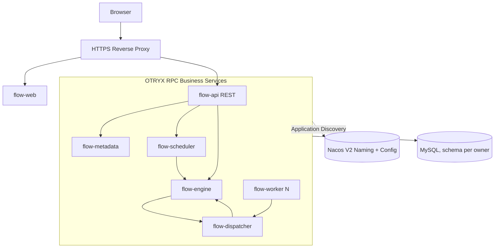

# OTRYX Flow

[简体中文](README.md) | [English](README.en-US.md)

> **M1 and M2 Issues #3–#8 have passed their required gates and merged** (see corresponding PRs/CI). Issue #9 is an independent PR for genuine Worker → Dispatcher terminal Outbox → Engine Inbox reconciliation and failure recovery. Completion requires five green gates on this exact PR head. Production Nacos mTLS and public HTTPS are not implemented.

<!-- doc-section:overview -->
## Overview
OTRYX Flow is a proposed distributed job scheduler and DAG workflow platform, using **OTRYX RPC** as the sole synchronous inter-service RPC stack. Intended deliveries include a Java Worker SDK, a Vue 3 administration site, independent services, recovery mechanisms, Docker images, a controlled HTTPS demo site, and auditable acceptance results.

The first release emphasizes trusted Java handlers, durable triggers, at-least-once task execution, leases, and fencing. It cannot offer general exactly-once side effects and must not expose arbitrary code execution on the public demo.

<!-- doc-section:architecture -->
## Architecture and baseline
- **Verified OTRYX RPC baseline**: `1.0.0-SNAPSHOT` / JDK 21 / Spring Boot 3.5.4; sole starter `com.peachsoft.otryx:otryx-spring-boot-starter`, **not published on Maven Central**. Pin a tested Git revision before implementing; see [source evidence](docs/09-references/source-evidence.md).
- **Proposed app stack**: Java 21 / Vue 3 + TypeScript / MySQL 8.4 LTS / Flyway / Nacos 3.2.4 / Docker Compose. Redis, RocketMQ, and Kubernetes are not mandatory dependencies for M1.
- **Proposed applications**: `flow-api`, `flow-metadata`, `flow-scheduler`, `flow-engine`, `flow-dispatcher`, `flow-worker`, `flow-web`. OTRYX RPC handles bounded control calls; a business outbox and durable state handle reliable delivery.

<!-- doc-section:scope -->
## Intended V1 scope
1. Project roles, versioned job definitions, Cron/manual triggers and misfire policies.
2. DAG editing/validation, version publishing, durable workflow instances and node recovery.
3. Worker Pull + Lease, idempotent completion, logs, audits, monitoring, alerts, and a restricted demo.
4. Docker Compose, HTTPS site, backup/rollback, frontend/backend E2E, and fault-injection tests.

**Out of scope**: public arbitrary Shell/Python execution, general distributed transactions, every cross-language SDK, or claims of exactly-once task side effects.

<!-- doc-section:docs -->
## Documentation
Read the [docs index](docs/index.md), then [requirements](docs/01-product/requirements-prd.md), [architecture](docs/02-architecture/architecture-overview.md), [core design](docs/03-design/consistency-and-recovery.md), [frontend spec](docs/05-frontend/ui-ux-spec.md), [acceptance](docs/06-testing/acceptance-plan.md), and [roadmap](docs/08-roadmap/milestones.md).

<!-- doc-section:status -->
## M1 verified; M2 in progress
M1 passed Maven, Vue, source, docs and real cross-JVM Docker Compose / Etcd / MySQL E2E and was squash-merged in [PR #2](https://github.com/Ryan-Guizhou/otryx-flow/pull/2).

The implemented M2 FLOW-008 [PR #10](https://github.com/Ryan-Guizhou/otryx-flow/pull/10) adds job drafts, durable idempotent creation, optimistic draft CAS, immutable published revisions, and a Vue Jobs page. See [M2 RPC/REST contracts](docs/04-api/m2-job-contracts.md) and [M2 acceptance](docs/06-testing/m2-job-acceptance.md). FLOW-009 merged in [PR #11](https://github.com/Ryan-Guizhou/otryx-flow/pull/11), adding a pure Cron/IANA time-zone preview ([design](docs/03-design/cron-timezone.md) · [API](docs/04-api/cron-preview.md)). FLOW-010 was merged in [PR #12](https://github.com/Ryan-Guizhou/otryx-flow/pull/12) with a two-replica durable Scheduler, unique Trigger and transactional Outbox ([implementation](docs/03-design/m2-scheduler-implementation.md) · [API](docs/04-api/m2-scheduler-contracts.md) · [acceptance](docs/06-testing/m2-scheduler-acceptance.md)); FLOW-011 was merged in [PR #13](https://github.com/Ryan-Guizhou/otryx-flow/pull/13), adding an independent Engine service, idempotent Inbox and reliable Outbox redelivery ([design](docs/03-design/m2-engine-outbox.md) · [RPC/REST](docs/04-api/m2-engine-contracts.md) · [acceptance](docs/06-testing/m2-engine-acceptance.md)). FLOW-012 merged in [PR #14](https://github.com/Ryan-Guizhou/otryx-flow/pull/14), adding a durable Dispatcher queue, epoch-fenced Worker leases, and Engine dispatch Outbox ([design](docs/03-design/m2-dispatcher-leases.md) · [RPC/REST](docs/04-api/m2-dispatcher-contracts.md) · [acceptance](docs/06-testing/m2-dispatcher-acceptance.md)). **FLOW-013 delivers trusted Java Worker SDK and Nacos Quickstart with real Dispatcher Attempt completion; FLOW-014 (#9) now adds durable Engine SUCCEEDED/FAILED outcomes and failure-recovery acceptance**; public deployment remains incomplete.

[Terminal Outbox/Inbox design](docs/03-design/m2-outcome-reconciliation.md) · [Full acceptance](docs/06-testing/m2-final-acceptance.md) · [Worker SDK design](docs/03-design/m2-worker-sdk.md) · [Quickstart](flow-worker-quickstart/README.md) · [Acceptance](docs/06-testing/m2-worker-acceptance.md). Nacos 3.2.4 is the **only active registry**; Etcd is no longer deployed. The [Nacos V2 Config mapping bootstrap](docs/07-operations/nacos-registry.md) must run before any RPC application. The pinned adapter does not support full mTLS, so `TRUSTED_DEVELOPMENT` must never be deployed publicly or to production.

<!-- doc-section:contribute -->
## Engineering
[AGENTS.md](AGENTS.md) · [Contributing](CONTRIBUTING.md) · [Security](SECURITY.md) · [Issue backlog](docs/08-roadmap/issue-backlog.md). Repository documentation is the canonical design source.

<!-- doc-section:license -->
## License
MIT is proposed; the bundle includes its license text. Dependencies and visual assets require separate license review before release.
