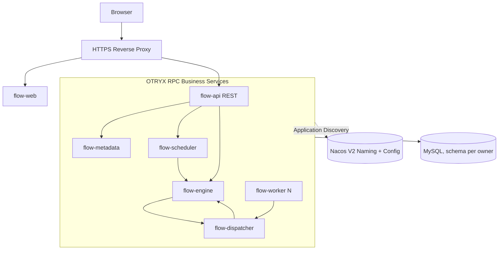

# OTRYX Flow

[简体中文](README.md) | [English](README.en-US.md)

> **已验收：M1 与 M2（Issue #3–#9）；M3 FLOW-015 / Issue #19 进入开发。** 生产 mTLS 与公网 HTTPS 尚未完成。

<!-- doc-section:overview -->
## 简介
OTRYX Flow 是拟议中的、以 **OTRYX RPC** 作为内部同步远程调用框架的分布式任务调度和 DAG 工作流平台。目标交付包含 Java Worker SDK、Vue 3 管理界面、独立微服务、运行与故障恢复、Docker 镜像、可受控访问的 HTTPS 演示站点，以及可复核的验收记录。

产品边界：可信 Java Handler、持久化触发、至少一次执行、租约与代际隔离；不承诺通用 Exactly Once，也不允许公网用户执行任意代码。

<!-- doc-section:architecture -->
## 技术基线与架构
- **OTRYX RPC 当前依据**：`1.0.0-SNAPSHOT` / JDK 21 / Spring Boot 3.5.4，唯一 Starter `com.peachsoft.otryx:otryx-spring-boot-starter`，**尚未发布到 Maven Central**。具体集成必须锁定并验证仓库提交；参考 [依赖事实与外部证据](docs/09-references/source-evidence.md)。
- **拟议业务栈**：Java 21 / Vue 3 + TypeScript / MySQL 8.4 LTS / Flyway / Nacos 3.2.4 / Docker Compose；Redis、RocketMQ、Kubernetes 不作为 M1 的强制前置条件。
- **拟议应用**：`flow-api`、`flow-metadata`、`flow-scheduler`、`flow-engine`、`flow-dispatcher`、`flow-worker`、`flow-web`。应用通过 OTRYX RPC 接口契约交互；任务交付依赖业务状态与 Outbox。

<!-- doc-section:scope -->
## 首发 V1 范围
1. 项目与角色权限、任务定义与版本、Cron/手动触发/错过触发策略。
2. 有向无环图编辑与校验、版本发布、可靠实例推进、节点执行/失败恢复。
3. Worker Pull + Lease、幂等完成、日志审计、监控告警与受限 Demo。
4. Docker Compose、HTTPS 站点、备份与回滚、前后端 E2E 和故障验证。

**非目标**：公网 Shell/Python 任意执行、完全通用分布式事务、跨语言 SDK 全覆盖、宣称“严格恰好一次执行”。

<!-- doc-section:docs -->
## 文档导航
从 [文档入口](docs/index.md) 开始，按 [需求 PRD](docs/01-product/requirements-prd.md) → [总体架构](docs/02-architecture/architecture-overview.md) → [核心设计](docs/03-design/consistency-and-recovery.md) → [前端规范](docs/05-frontend/ui-ux-spec.md) → [验收计划](docs/06-testing/acceptance-plan.md) → [实施路线图](docs/08-roadmap/milestones.md) 阅读。

<!-- doc-section:status -->
## M1/M2 以及 M3 FLOW-015 已验收；FLOW-016 开发中

M1 在 [PR #2](https://github.com/Ryan-Guizhou/otryx-flow/pull/2) 合并。M2 的分布式短任务闭环最终在 [PR #18](https://github.com/Ryan-Guizhou/otryx-flow/pull/18) 通过完整五项门禁并合并。M3 FLOW-015 / [PR #20](https://github.com/Ryan-Guizhou/otryx-flow/pull/20) 已通过最新 Head 的 Backend、Frontend、Source、Docs、真实 Nacos/MySQL/OTRYX RPC Compose 集成五项验收并合并 main，支持 DAG 定义校验、草稿 CAS、不可变 Revision。

M3 的实际 DAG 运行由 [Issue #21](https://github.com/Ryan-Guizhou/otryx-flow/issues/21) / [PR #22](https://github.com/Ryan-Guizhou/otryx-flow/pull/22) 实现，涵盖节点级独立派发、条件 SKIPPED、Outbox/Inbox 和故障恢复；该 PR 的真实多 Worker CI **尚未完成验收**。参见[运行时设计](docs/03-design/m3-dag-runtime.md)、[API](docs/04-api/m3-dag-runtime-contracts.md)、[验收门禁](docs/06-testing/m3-dag-acceptance.md)。

**边界：** 当前仅使用隔离开发网络 TRUSTED_DEVELOPMENT 和 Nacos 3.2.4。生产 mTLS、HTTPS 站点、完整取消重试与 Vue Flow 画布仍待后续阶段。

<!-- doc-section:contribute -->
## 工程协作
[AGENTS.md](AGENTS.md) · [贡献指南](CONTRIBUTING.md) · [安全策略](SECURITY.md) · [开发任务清单](docs/08-roadmap/issue-backlog.md)。业务设计讨论以本仓库文档为单一事实源。

<!-- doc-section:license -->
## License
计划采用 MIT；当前文档包附带 MIT 文本，未来依赖与资产许可证须在发布前单独审计。
