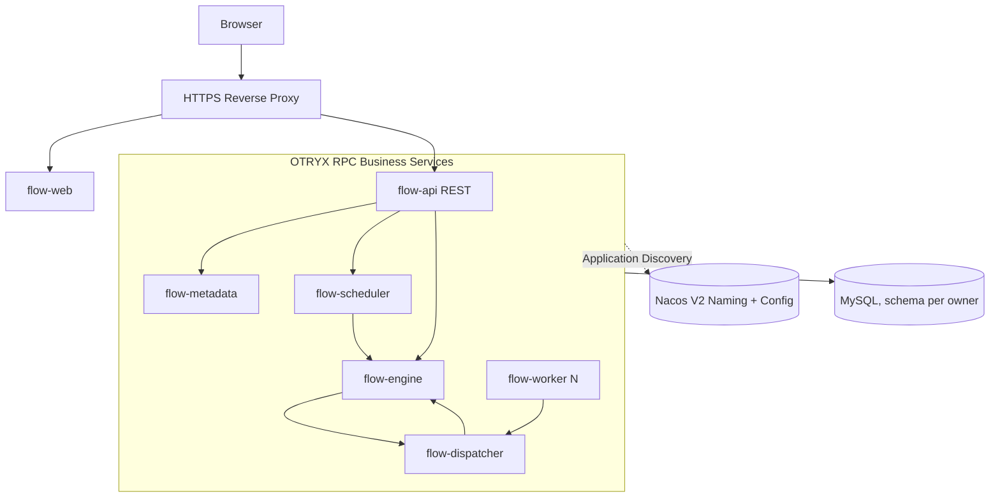

# OTRYX Flow

[简体中文](README.md) | [English](README.en-US.md)

> **核心业务主链路已实现：** M1/M2 与 M3 FLOW-015/016/017/018/019 已合并。可用 [一键本地启动](docs/07-operations/quickstart.md) 拉起 UI、调度服务与示例 Worker。指标栈是可选组件；生产 mTLS、配额/背压、备份恢复和公网 HTTPS 仍需后续完善。

<!-- doc-section:overview -->
## 简介
OTRYX Flow 是以 **OTRYX RPC** 作为内部同步远程调用框架的分布式任务调度和 DAG 工作流平台，包含 Java Worker SDK、Vue 3 管理界面和独立微服务。当前可在隔离开发环境运行核心调度与工作流功能；安全加固、集群运维和公网演示仍在路线图中。

产品边界：可信 Java Handler、持久化触发、至少一次执行、租约与代际隔离；不承诺通用 Exactly Once，也不允许公网用户执行任意代码。

首次启动执行 `./scripts/dev.sh up` 即可生成本地凭据、构建并运行应用。默认不启动 Prometheus、Grafana 或 OpenTelemetry Collector。

<!-- doc-section:architecture -->
## 技术基线与架构
- **OTRYX RPC 当前依据**：`1.0.0-SNAPSHOT` / JDK 21 / Spring Boot 3.5.4，唯一 Starter `com.peachsoft.otryx:otryx-spring-boot-starter`，固定提交 `502117d3301d78ea76a8d02b36e62585059d9902`，**尚未发布到 Maven Central**；参考 [依赖事实与外部证据](docs/09-references/source-evidence.md)。
- **拟议业务栈**：Java 21 / Vue 3 + TypeScript / MySQL 8.4 LTS / Flyway / Nacos 3.2.4 / Docker Compose；Redis、RocketMQ、Kubernetes 不作为 M1 的强制前置条件。
- **拟议应用**：`flow-api`、`flow-metadata`、`flow-scheduler`、`flow-engine`、`flow-dispatcher`、`flow-worker`、`flow-web`。应用通过 OTRYX RPC 接口契约交互；任务交付依赖业务状态与 Outbox。

<!-- doc-section:scope -->
## 首发 V1 范围
1. 项目与角色权限、任务定义与版本、Cron/手动触发/错过触发策略。
2. 有向无环图编辑与校验、版本发布、可靠实例推进、节点执行/失败恢复。
3. Worker Pull + Lease、幂等完成、日志审计、监控告警与受限 Demo。
4. Docker Compose、HTTPS 站点、备份与回滚、前后端 E2E 和故障验证。

**非目标**：公网 Shell/Python 任意执行、完全通用分布式事务、跨语言 SDK 全覆盖、宣称“严格恰好一次执行”。

<!-- doc-section:docs -->
## 文档导航
从 [文档入口](docs/index.md) 开始，按 [需求 PRD](docs/01-product/requirements-prd.md) → [总体架构](docs/02-architecture/architecture-overview.md) → [核心设计](docs/03-design/consistency-and-recovery.md) → [前端规范](docs/05-frontend/ui-ux-spec.md) → [验收计划](docs/06-testing/acceptance-plan.md) → [实施路线图](docs/08-roadmap/milestones.md) 阅读。

<!-- doc-section:status -->
## M1/M2 与 M3 FLOW-015/016/017/018/019 已验收；M4 正在推进

M1 合并于 [PR #2](https://github.com/Ryan-Guizhou/otryx-flow/pull/2)，M2 完整分布式短任务闭环合并于 [PR #18](https://github.com/Ryan-Guizhou/otryx-flow/pull/18)。M3 FLOW-015 / [PR #20](https://github.com/Ryan-Guizhou/otryx-flow/pull/20) 提供 DAG 校验与不可变版本；FLOW-016 / [PR #22](https://github.com/Ryan-Guizhou/otryx-flow/pull/22) 提供真实 Worker DAG 执行；FLOW-017 / [PR #24](https://github.com/Ryan-Guizhou/otryx-flow/pull/24) 完成持久取消、租约 fencing 与逻辑重试。三项均通过五项 CI 和真实 Compose 验收。

FLOW-018 / [PR #26](https://github.com/Ryan-Guizhou/otryx-flow/pull/26) 已通过五项门禁与真实 Compose 验收并合并，提供 Vue Flow DAG 编辑、草稿 CAS、不可变发布版本和固定 Revision 运行入口。

FLOW-019 / [Issue #27](https://github.com/Ryan-Guizhou/otryx-flow/issues/27) 已在 [PR #28](https://github.com/Ryan-Guizhou/otryx-flow/pull/28) 合并，交付 DAG Run 详情、Attempt 历史与有界脱敏日志。FLOW-021 / [Issue #30](https://github.com/Ryan-Guizhou/otryx-flow/issues/30) 的第一阶段在 PR #31 中交付 RPC Trace、核心业务指标和本地告警面板；RPC 指标语义、HTTP 安全事件计数与故障注入仍需补齐。FLOW-020 / [Issue #29](https://github.com/Ryan-Guizhou/otryx-flow/issues/29) 继续负责生产 RPC mTLS/Nacos TLS。

**边界：** 当前为 Nacos 3.2.4 的隔离开发环境；生产 mTLS/HTTPS、完整 Playwright 浏览器矩阵与外部副作用补偿仍是后续阶段。

<!-- doc-section:contribute -->
## 工程协作
[AGENTS.md](AGENTS.md) · [贡献指南](CONTRIBUTING.md) · [Java 工程编码规范](docs/engineering/java-coding-standard.md) · [安全策略](SECURITY.md) · [开发任务清单](docs/08-roadmap/issue-backlog.md)。业务设计讨论以本仓库文档为单一事实源。

<!-- doc-section:license -->
## License
计划采用 MIT；当前文档包附带 MIT 文本，未来依赖与资产许可证须在发布前单独审计。
