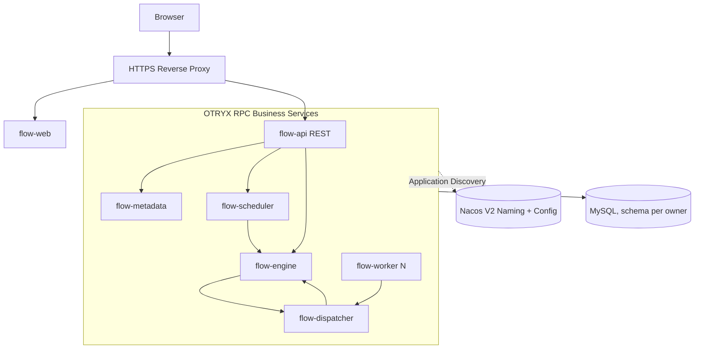

# OTRYX Flow

[简体中文](README.md) | [English](README.en-US.md)

> **已验证合并 M1 与 M2 Issues #3–#7**（main `9351a5e8`）。当前按 Issue #15 **将唯一注册中心切换到 Nacos 3.2.4**，需在真实 CI 通过后合并；Worker SDK（#8）和公网 HTTPS 尚未完成。

<!-- doc-section:overview -->
## 简介
OTRYX Flow 是拟议中的、以 **OTRYX RPC** 作为内部同步远程调用框架的分布式任务调度和 DAG 工作流平台。目标交付包含 Java Worker SDK、Vue 3 管理界面、独立微服务、运行与故障恢复、Docker 镜像、可受控访问的 HTTPS 演示站点，以及可复核的验收记录。

产品边界：可信 Java Handler、持久化触发、至少一次执行、租约与代际隔离；不承诺通用 Exactly Once，也不允许公网用户执行任意代码。

<!-- doc-section:architecture -->
## 技术基线与架构
- **OTRYX RPC 当前依据**：`1.0.0-SNAPSHOT` / JDK 21 / Spring Boot 3.5.4，唯一 Starter `com.peachsoft.otryx:otryx-spring-boot-starter`，**尚未发布到 Maven Central**。具体集成必须锁定并验证仓库提交；参考 [依赖事实与外部证据](docs/09-references/source-evidence.md)。
- **拟议业务栈**：Java 21 / Vue 3 + TypeScript / MySQL 8.4 LTS / Flyway / Nacos 3.2.4 / Docker Compose；Redis、RocketMQ、Kubernetes 不作为 M1 的强制前置条件。
- **拟议应用**：`flow-api`、`flow-metadata`、`flow-scheduler`、`flow-engine`、`flow-dispatcher`、`flow-worker`、`flow-web`。应用通过 OTRYX RPC 接口契约交互；任务交付依赖业务状态与 Outbox。

<!-- doc-section:scope -->
## 首发 V1 范围
1. 项目与角色权限、任务定义与版本、Cron/手动触发/错过触发策略。
2. 有向无环图编辑与校验、版本发布、可靠实例推进、节点执行/失败恢复。
3. Worker Pull + Lease、幂等完成、日志审计、监控告警与受限 Demo。
4. Docker Compose、HTTPS 站点、备份与回滚、前后端 E2E 和故障验证。

**非目标**：公网 Shell/Python 任意执行、完全通用分布式事务、跨语言 SDK 全覆盖、宣称“严格恰好一次执行”。

<!-- doc-section:docs -->
## 文档导航
从 [文档入口](docs/index.md) 开始，按 [需求 PRD](docs/01-product/requirements-prd.md) → [总体架构](docs/02-architecture/architecture-overview.md) → [核心设计](docs/03-design/consistency-and-recovery.md) → [前端规范](docs/05-frontend/ui-ux-spec.md) → [验收计划](docs/06-testing/acceptance-plan.md) → [实施路线图](docs/08-roadmap/milestones.md) 阅读。

<!-- doc-section:status -->
## M1 已验收，M2 开发中
M1 在 [PR #2](https://github.com/Ryan-Guizhou/otryx-flow/pull/2) 通过 Maven、Vue、源码、文档以及真实 Docker Compose 跨 JVM RPC 集成验收，已合并 main。

M2 FLOW-008 已在 [PR #10](https://github.com/Ryan-Guizhou/otryx-flow/pull/10) 完成：任务草稿、幂等创建、乐观版本 CAS、不可变发布 Revision 及 Vue 任务页面。参见 [M2 RPC/REST 契约](docs/04-api/m2-job-contracts.md) 和 [M2 验收计划](docs/06-testing/m2-job-acceptance.md)。FLOW-009 已于 [PR #11](https://github.com/Ryan-Guizhou/otryx-flow/pull/11) 合并无副作用的 Cron/IANA 时区预览（[设计](docs/03-design/cron-timezone.md) · [API](docs/04-api/cron-preview.md)）。FLOW-010 已在 [PR #12](https://github.com/Ryan-Guizhou/otryx-flow/pull/12) 完成双副本持久化 Scheduler、唯一 Trigger 与事务 Outbox；参见 [实现](docs/03-design/m2-scheduler-implementation.md)、[API](docs/04-api/m2-scheduler-contracts.md) 与 [验收](docs/06-testing/m2-scheduler-acceptance.md)。FLOW-011 已于 [PR #13](https://github.com/Ryan-Guizhou/otryx-flow/pull/13) 引入独立 Engine、Inbox 幂等和 Outbox 可靠重投（[设计](docs/03-design/m2-engine-outbox.md) · [RPC/REST](docs/04-api/m2-engine-contracts.md) · [验收](docs/06-testing/m2-engine-acceptance.md)）。FLOW-012 已合并 [PR #14](https://github.com/Ryan-Guizhou/otryx-flow/pull/14)：[Dispatcher/Lease 设计](docs/03-design/m2-dispatcher-leases.md) · [RPC/REST 契约](docs/04-api/m2-dispatcher-contracts.md) · [验收](docs/06-testing/m2-dispatcher-acceptance.md)。**尚未提供 Worker SDK 自动执行和最终结果回传 Engine**，公网部署也未完成。

注册中心仅支持 **Nacos 3.2.4**，不再部署 Etcd。首次部署前必须完成 [Nacos V2 Config 分片初始化](docs/07-operations/nacos-registry.md)。当前适配器仍限制为 `TRUSTED_DEVELOPMENT`，不可公网或生产使用。

<!-- doc-section:contribute -->
## 工程协作
[AGENTS.md](AGENTS.md) · [贡献指南](CONTRIBUTING.md) · [安全策略](SECURITY.md) · [开发任务清单](docs/08-roadmap/issue-backlog.md)。业务设计讨论以本仓库文档为单一事实源。

<!-- doc-section:license -->
## License
计划采用 MIT；当前文档包附带 MIT 文本，未来依赖与资产许可证须在发布前单独审计。
