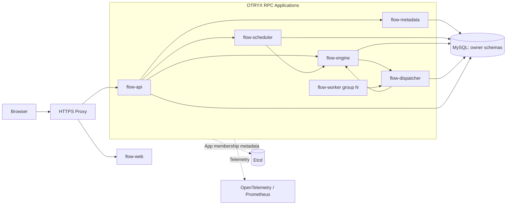
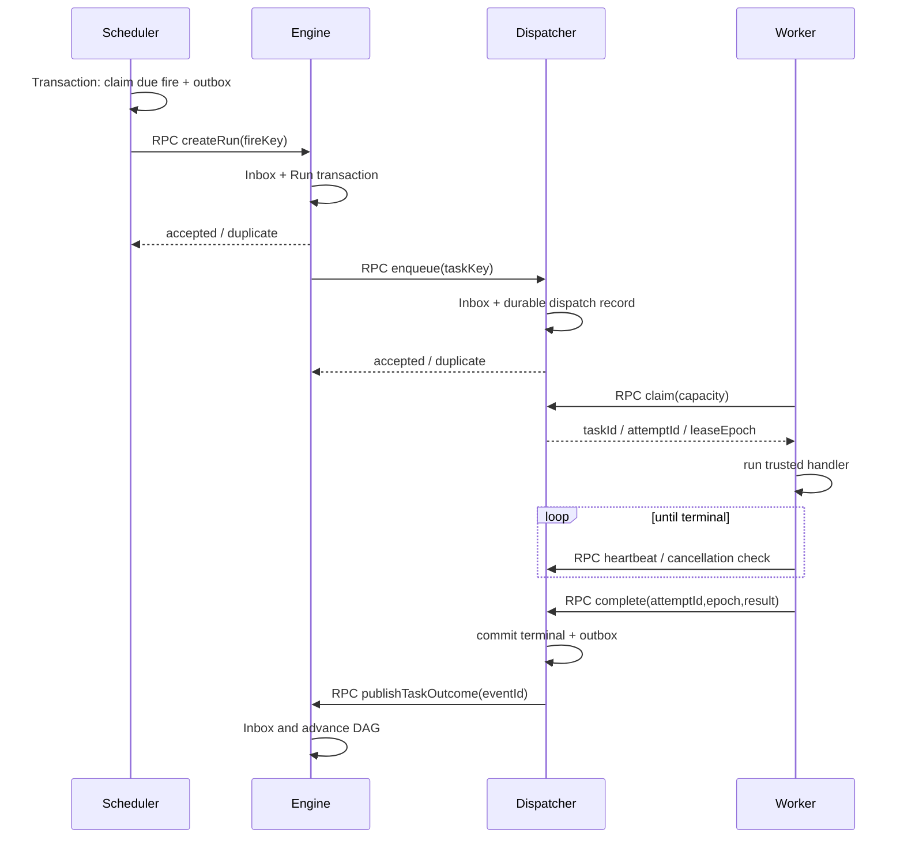

# 系统总体架构（Proposed）

## 1. 决策摘要
OTRYX Flow 采用“REST 入口 + OTRYX RPC 服务间调用 + 持久化执行控制面 + Worker Pull/Lease”的混合架构。选择该方式而非“Scheduler 直接给 Worker 推送并等待执行完成”，因为 RPC Unary 调用不应绑定长时间任务生命周期，也不能承担断电后可靠投递功能。对每个外部调用失败均有明确重试、限流和权限边界。

## 2. 容器级拓扑

1. 浏览器只调用 `flow-api` 的 REST，`flow-web` 是静态资产。`flow-api` 统一认证、项目权限检查与对外交付错误码。
2. 业务服务间仅用 OTRYX RPC；任务完成不能依赖一次 RPC 成功确认，必须有事务 Outbox、下游 Inbox 或幂等持久状态。
3. `flow-worker` 为跨进程 Consumer，使用 RPC 向 Dispatcher 领取/心跳/上报。OTRYX 应用级注册用来发现**服务进程**，具体 Worker 容量和任务租约属于 **Flow 业务数据库**。
4. 每个服务只写自己的 Schema；跨服务通过契约交换 ID 和版本，不能跨库 FK、JOIN 或隐藏直写。

## 3. 控制平面和数据平面
控制平面：用户定义/版本、Cron fire、任务队列、运行状态、Worker 逻辑配额、指标查询。同步 RPC 负责查询和受理命令；MySQL 唯一索引与状态版本负责正确性。
执行平面：Worker 执行可信 Handler，长业务运行独立于 RPC 连接；Worker 定期 RPC 续租与报告事件。任务日志分块持久化，不依赖 RPC Stream（当前基线为 Unary）。

## 4. 业务链路序列

## 5. 一致性定义
- **唯一逻辑 Run**：火点幂等键由数据库唯一约束实现；可能收到多次提交 RPC，但只有一个逻辑 run。
- **至少一次 Handler 尝试**：Worker 崩溃或确认丢失时可能重试；业务外部效果不保证 Exactly Once。
- **提交授权**：Dispatcher 使用 `attemptId+leaseEpoch` 做比较并交换；旧 Worker 不能覆盖新 Attempt 的状态，但不能撤销它对外部系统已发生的副作用。
- **恢复**：服务启动后对超时租约、未确认 Outbox、无法映射的事件作补偿扫描；在恢复不确定时标记 `UNKNOWN_RECOVERY` 并可人工复核。

## 6. OTRYX RPC 依赖与限制
当前仓库唯一 Starter、应用级 Provider/Consumer 注册、Deadline、mTLS 等能力见 [源证据](../09-references/source-evidence.md)。本项目尚未验证任何自定义 Flow RPC 签名；M1 必须从真实 `otryx-rpc main` 提交锁定 BOM/SHA，测试 A→B→C 真实跨 JVM 并在 Linux mTLS 网络 Profile 验证拒绝/授权/恢复路径。不得把 Registry 内存模式跨 JVM 使用。

## 7. 设计替代方案
| 方案 | 优点 | 拒绝/采用理由 |
|---|---|---|
| Scheduler 同步推送并等待 Worker 完成 | 简单 | 长任务导致 RPC 占用，失败后难确定执行结果；拒绝 |
| Broker 原生任务队列 | 高吞吐、消峰 | 增加基础设施复杂度与消息投递/租约语义；V1 预留适配，暂不强制 |
| DB 持久化领取 + Worker Pull | 故障恢复和审计容易、基础设施少 | 表热点与吞吐上限需要压测；V1 采用 |
| 共享单库跨服务事务 | 初期省事 | 数据耦合、阻碍独立部署；拒绝，采用每服务 Schema + Outbox |
