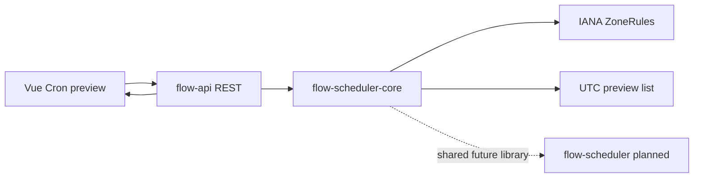

# Cron 表达式、IANA 时区与 DST 预览（FLOW-009）

> Proposed/Implementation candidate. Cron **预览计算**独立于任务发布和 Scheduler 真正调度，不能将预览当作持久化触发。参见 [Issue #4](https://github.com/Ryan-Guizhou/otryx-flow/issues/4)。

## 设计目标

1. 在 Java 21 和 Spring 6.2 对应的 `CronExpression` 上使用 **6 字段**表达式（秒 分 时 日 月 星期），拒绝 Quartz 年字段和非法语法；调用频率由 REST 与运营网关限制。
2. 使用明确的 **IANA `ZoneId`**（如 `Asia/Shanghai`、`Europe/Berlin`），拒绝未知或伪造时区标识。
3. UTC `Instant` 是返回结果的唯一执行时序依据；本地时间与偏移仅用于用户解释。
4. 预览是纯函数：不访问数据库，不更新调度游标，不领取租约，不执行 Handler。
5. `limit` 为 1—20、Cron 最多 120 字符、时区标识最多 64 字符；不允许无限求值循环。

## DST 处理策略

- **Spring forward (gap)**：本地钟点不存在时跳过，例如柏林 2026-03-29 02:30。
- **Fall back (overlap)**：本地钟点出现两次时仅采用**较早 UTC Instant / 较早偏移实例**（`ZoneRules.getValidOffsets(...).getFirst()`），随后跳过重复偏移实例，避免单日同一任务因折返触发两次。
- 请求的 `fromUtc` 为严格开区间，结果 UTC 单调递增。此预览与未来 Scheduler 的触发唯一键策略必须保持一致；调度落库时另外负责错过执行、租约、时钟与持久化去重。

## 共用核心与后续边界

`flow-scheduler-core` 提供 `CronScheduleCalculator.preview(expression, zone, fromUtc, count)`，该模块只依赖 Spring Cron 解析器。`flow-api` 的 REST 预览与未来 `flow-scheduler` 共用该核心，避免后台真正触发与页面显示采用不同算法。

**本阶段不实现** Cron 持久化关联、唯一触发事务、Misfire 和高可用 Scheduler；分别由 FLOW-010 及后续 Issue 承担。

## 验收与证据

- UTC 开区间精确预览、最大 20 个返回值；非法 Cron/时区/超限返回 400。
- 柏林 2026-03-29 DST gap 跳过 02:30；2026-10-25 overlap 不会输出两个相同本地 02:30。
- 前端可填写 Cron 和 IANA 时区并浏览实际 UTC 时间，不显示虚假的执行记录。
- 在 `flow-scheduler-core` JUnit、`flow-api` 单元测试、Node API 测试和 Docker Compose 真实 HTTP E2E 中验证。
