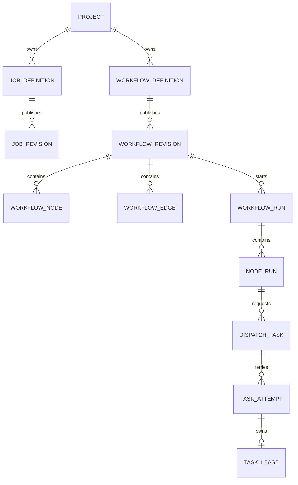

# 数据模型与所有权（Proposed）

## 1. Schema 分区
- `flow_identity`：`sys_user`、`sys_role`、`project`、`project_member`、`audit_log`。
- `flow_meta`：`job_definition`、`job_revision`、`workflow_definition`、`workflow_revision`、`workflow_node`、`workflow_edge`。
- `flow_schedule`：`schedule_definition`、`schedule_trigger`、`outbox_event`。
- `flow_engine`：`workflow_run`、`node_run`、`execution_event`、`outbox_event`、`inbox_dedup`。
- `flow_dispatch`：`dispatch_task`、`task_attempt`、`task_lease`、`worker_presence`、`execution_log_chunk`、`outbox_event`、`inbox_dedup`。

各服务独立 DB 用户，仅赋其 Schema 的最小权限。跨 Schema 使用不加 DB 外键的业务 ID 引用，由 RPC Query 验证存在性。所有可修改表需要 `created_at`、`updated_at`、`version`/CAS；审计事件不得原地覆盖。

## 2. 主要关系


上图是**逻辑关系**，不是跨服务 MySQL 外键 DDL。完整的外部 key、分片/保留策略需在各模块数据库迁移中落实。

## 3. 主键与唯一性
| 表 | 关键字段（建议） | 唯一/索引约束 |
|---|---|---|
| `job_revision` | `job_id`, `revision`, `content_hash`, `immutable_doc` | UNIQUE `(job_id, revision)` |
| `workflow_revision` | `workflow_id`, `revision`, `schema_version`, `graph_hash` | UNIQUE `(workflow_id, revision)` |
| `schedule_trigger` | `schedule_id`, `revision`, `planned_fire_at_utc`, `origin`, `dedupe_key` | UNIQUE `(schedule_id, revision, planned_fire_at_utc, origin)`；UNIQUE `(dedupe_key)` |
| `workflow_run` | `project_id`, `revision_id`, `trigger_key`, `status`, `version` | UNIQUE `(trigger_key)` |
| `node_run` | `workflow_run_id`, `node_id`, `status`, `version` | UNIQUE `(workflow_run_id, node_id)` |
| `dispatch_task` | `dispatch_key`, `status`, `lease_epoch`, `due_at`, `version` | UNIQUE `(dispatch_key)`；INDEX `(status, due_at)` |
| `task_attempt` | `dispatch_task_id`, `attempt_no`, `worker_id`, `lease_epoch` | UNIQUE `(dispatch_task_id, attempt_no)` |
| `task_lease` | `dispatch_task_id`, `attempt_id`, `lease_epoch`, `lease_until` | UNIQUE `(dispatch_task_id)` |
| `outbox_event` | `event_id`, `aggregate_id`, `payload`, `next_retry_at`, `status` | UNIQUE `(event_id)`；INDEX `(status, next_retry_at)` |
| `inbox_dedup` | `consumer`, `event_id`, `applied_at` | UNIQUE `(consumer, event_id)` |

## 4. 示例 DDL（设计草案，不可直接部署）
以下 SQL 演示数据库唯一键和版本列的设计，不是完整迁移文件；M1/M2 必须经 Flyway 实现并实测。

```sql
CREATE TABLE flow_dispatch.dispatch_task (
  id BIGINT UNSIGNED NOT NULL AUTO_INCREMENT PRIMARY KEY,
  project_id VARCHAR(64) NOT NULL,
  dispatch_key VARCHAR(180) NOT NULL,
  status VARCHAR(32) NOT NULL,
  due_at DATETIME(6) NOT NULL,
  lease_epoch BIGINT UNSIGNED NOT NULL DEFAULT 0,
  version BIGINT UNSIGNED NOT NULL DEFAULT 0,
  created_at DATETIME(6) NOT NULL,
  updated_at DATETIME(6) NOT NULL,
  UNIQUE KEY uk_dispatch_key (dispatch_key),
  KEY idx_claim (status, due_at)
) ENGINE=InnoDB;
```

## 5. 数据生命周期和机密性
原始用户输入采用 Schema 白名单校验，JSON 大字段和日志分块有明确上限。数据库加密备份，日志与运行产物设置存储保留期；创建时记录任务身份、版本与用户操作审计。清理任务只删除已超过保留期的终态数据，禁止在未判定状态时丢弃租约和未交付 Outbox。
