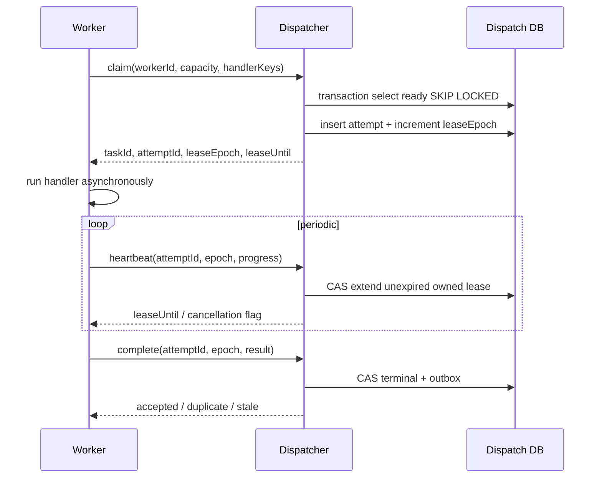

# Dispatcher 与 Worker 详细设计（Proposed）

## 1. 核心不变量
- `DispatchTask` 是待领取的**逻辑任务**；`TaskAttempt` 是一次真实执行尝试；`WorkerPresence` 是业务集群状态，不等于 OTRYX Registry 的应用成员。
- 任务物理执行默认 at-least-once；同一时刻最多一个有效 Lease Epoch 能提交权威终态（不代表旧 Worker 的外部副作用被阻止）。
- Worker 的本地线程执行 Handler，与 RPC 请求 Future、超时和连接健康解耦；RPC 只用于快速 Claim、Heartbeat、Complete、CancelCheck。

## 2. 领取和续租

所有租约有效性以数据库可信时间比较，支持租约时长可配置；网络 RTT、GC Pause、Job 时间差异是容量预估输入。`leaseEpoch` 必须对同一 `dispatch_task` 单调增长，领取必须带持久 Attempt；同一 `Complete` 重放返回相同业务结果而不是再转移状态。

## 3. 资源模型
- Worker 注册 `group`、`handlerKey:version`、`labels`、`maxConcurrent` 和受保护的身份；领取请求最多返回剩余容量可运行任务。
- Dispatcher 检查项目级配额、Worker 组配额、每 Handler 限额、租约数量和队列积压；拒绝时有固定错误码与 retryAfter 建议值。
- 可信阻塞 IO Java Handler 使用受限并发执行器（可评估虚拟线程），CPU 密集任务用受限平台线程池；任何 Handler 不在 OTRYX EventLoop 运行。
- Runner 不接受来自公网任意脚本、任意 Java ClassName、未验证 JAR 上传和无条件外网访问。
- 任务参数大小、执行超时、日志体量、返回结果大小都限额；主动停止和进程终止需有明确事件日志。

## 4. 取消和迟到结果
Client 发起取消仅把 DispatchTask 标为 `CANCEL_REQUESTED`，后续 Heartbeat 返回取消标志。Worker 协作式中断，Handler 可能拒绝中断或已发生不可逆副作用；当 Worker 确认实际停止，Dispatcher 才记录 `CANCELED`。租约过期但业务仍可能活着，旧结果被 epoch 拒绝；如果是不可重试的外部副作用任务，可以转入 `UNKNOWN_RECOVERY` 等人工确认，不能盲目重放。

## 5. 失败分类
`HANDLER_RETRYABLE`、`HANDLER_PERMANENT`、`DEADLINE_EXCEEDED`、`LEASE_EXPIRED`、`WORKER_LOST`、`RPC_TRANSIENT`、`PAYLOAD_INVALID`、`AUTH_DENIED`、`CAPACITY_REJECTED`。只有明确可重试类别进入指数退避+抖动；证书身份和授权错误不当作普通网络重试。

## 6. Worker SDK 契约
建议暴露 `TaskContext`（runId、attemptId、idempotencyKey、deadline、cancelFlag、logger、bounded progress）及 `TaskHandler#execute(context,input)`；这是新项目**拟议** API，不存在于当前 OTRYX RPC 中。输入结果 DTO 必须通过白名单/Schema 检验；SDK 支持生命周期 Start/Drain/Stop，优雅退出先停止 Claim，再给正在运行的任务有界完成窗口。

## 7. 验收
Worker A 领取→失联→Worker B 新 Epoch→A 迟到 Complete、重复完成、取消失败、Handler 忽略中断、Worker 资源额度超限都需要独立测试（AT-08、AT-09、AT-10、AT-13）。
