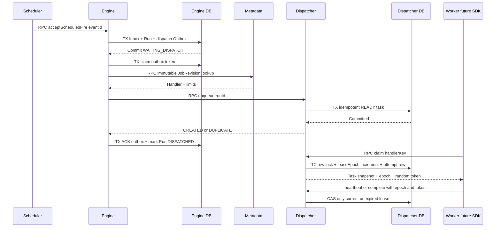
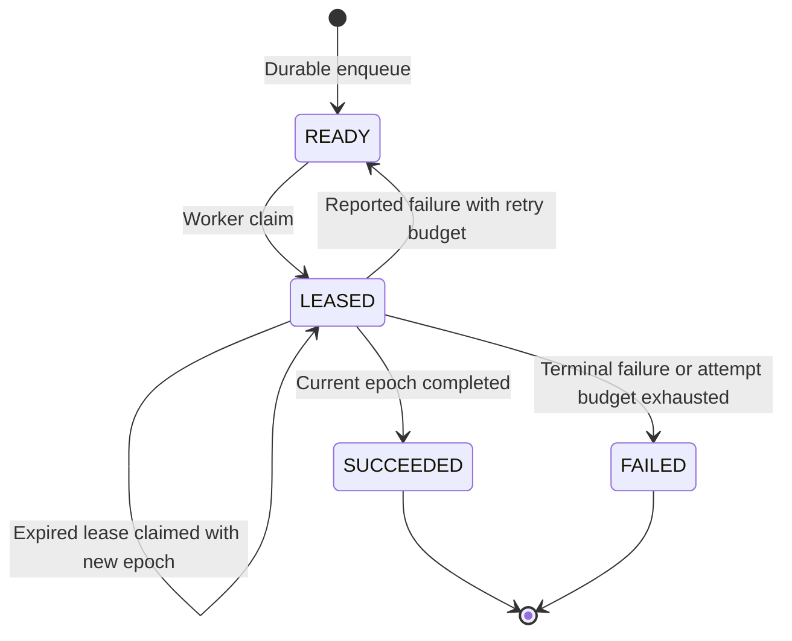

# M2 FLOW-012：Dispatcher 持久任务队列、Lease 与 Fencing

> **Issue #7 / PR 开发候选**。当前 `main` 已完成 Scheduler → Engine Inbox/Run，Dispatcher 新能力必须在当前 PR 的 Java/前端/Compose CI 通过后才算实现。当前仅提供领取/心跳/完成 RPC；**Java Worker SDK 与 Engine 终态协调仍为 #8/#9 后续工作**。

## 目标与服务边界

`flow-engine` 仍唯一拥有 `flow_workflow_run`；新建 `flow_dispatcher` MySQL Schema 由独立 `flow-dispatcher` 服务管理，任何跨服务交互均通过 OTRYX RPC。Engine 接收 Scheduler Fire 时在**同一事务**写 Inbox、Run 和 `flow_engine_dispatch_outbox`。Relay 先用短事务领取，**事务外**查询 Metadata 不可变 JobRevision，然后调用 Dispatcher RPC `enqueue`。Dispatcher 使用 `engine_run_id` 唯一索引和 payload SHA-256 指纹防止重复或篡改。得到持久化正向回执后，Engine 将 Outbox 改为 `DELIVERED` 并将 Run 标记为 `DISPATCHED`，但 **DISPATCHED 不代表 Worker 执行**。

### 跨服务顺序图

## 强一致本地不变量

- 一条逻辑 Run (`engine_run_id`) 在 Dispatcher 队列中最多一条 Task；`event_id` 也建立 UNIQUE。不同载荷或伪造事件用同一个 `runId` 会得到 `CONFLICT`，不能覆盖。
- 每次成功领取时 `lease_epoch` 只增不减；`flow_dispatch_attempt` 的 `(task_id,lease_epoch)` 为唯一主键。Worker 必须回传 `taskId + workerId + leaseEpoch + leaseToken`。
- `heartbeat` 和 `complete` 额外要求 `lease_until > DB_CURRENT_TIMESTAMP`，过期的旧 Worker 被拒绝，不能抢先确认结果；超时后被新 Worker 接管时 epoch 必然递增。
- `READ COMMITTED + FOR UPDATE SKIP LOCKED` 避免双 Dispatcher 实例同时领取同一个任务；一轮最多领取 **8** 个任务，支持 `handlerKey` 精确匹配。领取时先原子转为 `LEASED`，再在同一事务记录 Attempt。
- `FAILED` 的 Worker 结果在剩余尝试次数内退避并回到 `READY`；`SUCCEEDED` 为终态。过期且已耗尽尝试次数的 Task 由 Reaper 置 `FAILED`；旧代际之后的完成结果仍为 `STALE`。
- `Flow API` 仅提供有 Session 鉴权的只读 `dispatch-tasks`；**不把领取 token 或完成 RPC 开放到公共 REST**。Worker ID 仍为开发态声明，生产需要在 #8 校验受信任身份（mTLS/工作负载绑定）。

## 状态机

## 恢复与异常

| 场景 | 行为 | 可检查证据 |
| --- | --- | --- |
| Engine Run 已提交，但 Dispatcher 不可用 | Engine Outbox `PENDING` 并指数退避重投 | Outbox `attempts` 与 `next_attempt_at` |
| Dispatcher 已入队但 ACK 丢失 | Engine 重投相同 `runId`，Dispatcher 返回 `DUPLICATE` | Dispatcher Task COUNT 不增 |
| Worker 离线、租约过期 | 下次 Claim 使用更大的 epoch；上一 Attempt 记 `EXPIRED` | Task `lease_epoch` 与 Attempt 表 |
| 旧 Worker 迟到回执 | `STALE`，不允许改变 Task 最新状态 | Engine & Dispatcher 审计 |
| 第 N 次租约过期且 N 达到预算 | Reaper 标记 `FAILED` | `status=FAILED` / Attempt `EXPIRED` |
| Engine/Dispatcher 进程重启 | 同一 MySQL Schema 的下一个实例继续扫描 | CI 启停和数据库主键验收 |

## 限制与下一阶段

目前支持开发版受信任 handler 标识、每 RPC 8 条领取、最大 16KiB JSON 参数、JobRevision 固定重试/超时策略。**不允许用户自由执行脚本或反射实例化 Java 类**。任务失败重试只是 Dispatcher 队列状态转移；**Engine 尚不从 Dispatcher 消费最终 Outcome，流程的完成状态不能被推断**。Worker SDK、自动心跳、Handler 白名单、取消、全局在途配额和生产级身份绑定留待 #8/#9，并由验收报告明确区分。

当前 Compose `TRUSTED_DEVELOPMENT` 仅限封闭网络。`/_e2e/dispatch/*` 是 `e2e` Spring profile 下的 CI 内部测试辅助入口：默认 profile 不注册，Dispatcher 无主机端口映射；**不得在生产启用 e2e profile**。生产部署仍须使用 OTRYX `NETWORK_MTLS` + 受保护注册中心。
