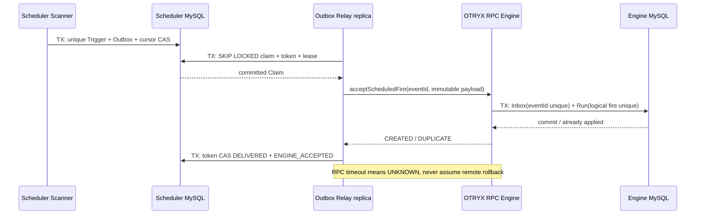

# FLOW-011：Engine Inbox / Run 与 Scheduler Outbox Relay（实施说明）

> 状态：Issue #6 PR 候选。Merge 及 CI 证据以 GitHub PR 运行结果为准。当前 **不执行** Worker Handler，也没有完整 DAG 节点推进。

## 目标与不变量

- `flow-scheduler` 已有 `Trigger + Outbox + Cursor` 同事务提交。通过独立短事务领取待交付事件，不在锁持有期间执行 OTRYX RPC。
- `flow-engine` 拥有唯一 `eventId` Inbox + 唯一逻辑火点 Run；接收某一事件时由 Engine 的 **同一 MySQL 事务**提交 Inbox 与 `flow_workflow_run`。
- 相同 `eventId` / 相同消息体：返回 `DUPLICATE`，保持同一个 `runId`；相同 `eventId` / 不同内容：`CONFLICT`，拒绝覆盖；不同 `eventId` 企图复用同一 `(scheduleId, revision, UTC fire, origin)`：DB UNIQUE 拒绝。
- Scheduler 收到 `CREATED/DUPLICATE` 才将 Outbox CAS 为 `DELIVERED`、Trigger 标记 `ENGINE_ACCEPTED`。RPC 超时、Engine 崩溃或 ACK 丢失必须安全重投 **相同 eventId**。
- `WAITING_DISPATCH` 意味着 Engine 已经创建逻辑 Run，**不代表任务已经执行、成功或领取租约**。下一阶段 Dispatcher 实现真正的任务派发。

## 拓扑与信任边界

Scheduler 与 Engine 使用两个数据库 Schema `flow_scheduler` 和 `flow_engine`；两个 MySQL Schema 当前位于同一个本地 Compose MySQL 实例，但业务代码禁止跨库事务和远程 SQL 访问。同步依赖是 OTRYX RPC，持久保障是 Outbox/Inbox 而非 RPC 自带重试。

## 协议 / 索引

| 表 | 关键唯一约束 | 作用 |
|---|---|---|
| Scheduler `flow_schedule_trigger` | `(schedule_id, schedule_revision, planned_fire_at_utc, origin)` | 同一计划窗口至多一个逻辑火点 |
| Scheduler `flow_schedule_outbox` | `event_id PK`, `trigger_id UNIQUE` | 业务火点与待交付事件 1:1 |
| Engine `flow_engine_inbox` | `event_id PK`, `run_id UNIQUE` | 幂等 ACK、记录原始事件指纹 |
| Engine `flow_workflow_run` | `event_id UNIQUE`, `(schedule_id, schedule_revision, planned_fire_at_utc, origin) UNIQUE` | 一个逻辑火点至多一个 Run |

`eventId` 是 Scheduler 在生成 Trigger 时的稳定 UUIDv3；Engine 不能自行重写。载荷包含 `ownerUsername`, `projectId`, `scheduleId`, `scheduleRevision`, `jobId`, `jobRevision`, `plannedFireUtc`, `origin`。Engine 将所有字段按固定规则 SHA-256 指纹化，拒绝复用事件 ID 篡改负载。所有时间按 UTC MySQL 会话读写。调用者身份必须在边界可信，开发的 `TRUSTED_DEVELOPMENT` 不是公网安全配置。

## 租约与重试

- 每次领取最多 8 条；`READ COMMITTED / FOR UPDATE SKIP LOCKED`；`IN_FLIGHT` 设置随机 `claim_token`、45 秒 `lease_until`、`attempts++`。
- RPC **不在**数据库事务内。收到正向回执后进行 `eventId + claim_token + IN_FLIGHT` CAS；旧领取者已失去 token 时不能标记成功。
- 失败恢复为 `PENDING`，指数延迟递增、最长 60 秒。超时等于结果未知，下一次使用原 `eventId` 重发。
- `IN_FLIGHT` 超时自动进入下一次可领取集合，支持 Scheduler 节点宕机接管。
- 消息损坏或 Engine 报 `CONFLICT` 时标记 `DEAD` 并记错误日志，**不绕开校验**；管理员需要人工排查/审计后方可恢复（自动恢复 API 暂不实现）。
- 领取和 ACK 各持有本地短事务。数据库不可用时停止对外宣称交付成功。

## 故障与验收

| 场景 | 期望 |
|---|---|
| 双 Scheduler 同时领取 | 同一时刻至多一个有效 token；若锁过期，最多多一次远程投递，不多一条 Run |
| Engine 已提交 Run / RPC ACK 丢失 | Outbox 重新领取并返回 `DUPLICATE`，Run 总数不变 |
| Engine 创建 Inbox 后 Run 插入失败 | 整笔 Engine 事务回滚；Inbox 不残留孤儿记录 |
| Engine 与 Scheduler 任一实例重启 | 仍可消费历史未确认事件；`runId` 不变 |
| eventId 相同但负载变化 | `CONFLICT` -> Outbox `DEAD`，不得覆盖既有 Run |
| 用户查询其它所有者项目 | 不返回 Engine 数据；REST 强制登录，RPC 结果按数据库 owner/project 过滤 |

## 边界与后续

M2 当前是“持久化调度 → 持久化执行实例”，没有 Worker 的任务领取、租约、实际 Java Handler 调用。后续 Issue #7 实现 Dispatcher，Issue #8 实现 Worker；执行语义是至少一次，不保证外部不可逆副作用恰好一次。
