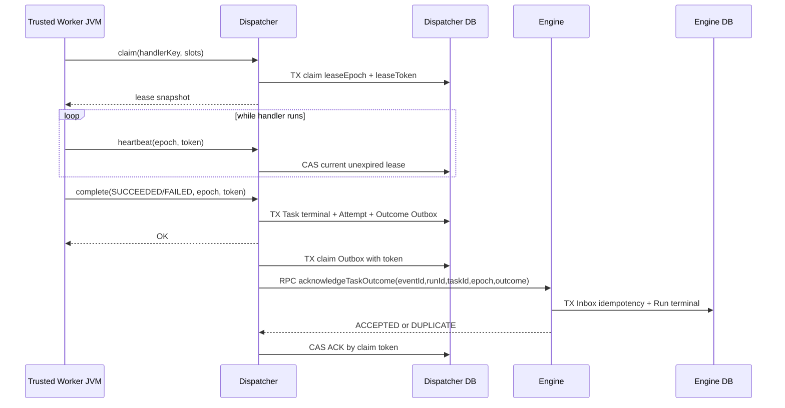

# FLOW-014：Dispatcher 终态回传、Engine Run 收敛与 M2 综合验收

> Issue #9 的开发候选。必须基于已合并的 Nacos-only #15 与 Worker SDK #8，全部门禁、真实跨 JVM 及恢复证据通过后才合并。这里只覆盖**单节点可信 Handler 的逻辑执行闭环**，完整 DAG 编排属于后续阶段。

## 目标与边界

- Dispatcher 只拥有 `flow_dispatch_task`、Attempt 和 `flow_dispatch_outcome_outbox`；绝不写 Engine Schema。
- Worker SDK 通过 Nacos OTRYX RPC 领取、续租、完成，成功/最终失败以 Dispatcher 数据库为事实源。
- Dispatcher 在**同一短事务**内提交 Attempt/Task 终态及 Outcome Outbox，网络 RPC 在事务**外**由定期 Relay 投递。
- Engine 在**同一事务**内提交 Outcome Inbox（事件唯一键、Run 唯一键）和 `flow_workflow_run` 终态。重复事件安全；内容冲突拒绝，数据库不会从 `SUCCEEDED` 退化为 `DISPATCHED`。
- ACK 丢失时，Dispatcher 以同一 eventId、runId 重投；任何旧代际 Worker 都被 Dispatcher 的 leaseEpoch + token + 未过期校验拒绝，**不能生成终态 Outbox**。

## 序列图：可信 Worker 到最终 Run 状态

当失败仍有重试预算时 Task 回到 `READY`，不发出 Engine 终态。租约耗尽的 Reaper 也必须在事务里写 `FAILED` Outbox。终态跨服务传播不需要也不允许分布式事务。

## 正确性不变量

1. `flow_dispatch_outcome_outbox.engine_run_id` 唯一：一个 Run 只能有一个正式终态事件。
2. `flow_engine_outcome_inbox.event_id` 与 `engine_run_id` 均唯一：相同 eventId 与完整载荷返回 DUPLICATE；改变内容或事件 ID 但复用 Run 返回 CONFLICT。
3. Engine 只能从 `WAITING_DISPATCH` 或 `DISPATCHED` 进入 `SUCCEEDED` / `FAILED`，终态不可被 EngineDispatchRelay 的迟到 ACK 回退。
4. 只有当前合法未过期的 Lease 能完成 Task。Worker 被杀、租约过期、续期失联只会产生至少一次尝试，外部副作用不具备 Exactly Once 保证。
5. Relay 有有界批次、45 秒领取租约、失联重投、有限退避和 `DEAD` 隔离；任何时刻不在持有 DB 事务时等待远端 RPC。
6. Web 端仅显示 Project/Owner 范围内的 Run 和 Task 状态，不公开 Worker token；`SUCCEEDED` 是可信 Handler 完成被 Dispatcher 接受并被 Engine 持久化，不是下游外部副作用 Exactly Once。

## 故障矩阵

| 故障 | 不变量/恢复行为 |
|---|---|
| 重复提交同一 Scheduler Fire | Engine Inbox 唯一 Run；Dispatch task 唯一 |
| Dispatcher ACK 丢失 | Engine Dispatch Outbox 重投，队列仍一条 |
| Worker 在执行中崩溃 | 租约到期后更高 epoch 接管；旧 Worker 的回执 STALE |
| Worker 报告失败但尚有尝试数 | READY 退避，**不通知 Engine 终态** |
| Worker 最终失败/过期预算耗尽 | Dispatcher 原子 `FAILED + Outcome Outbox`，Engine 终态 FAILED |
| Engine 写入 Outcome 后回复丢失 | 同 eventId 重投，Engine Inbox DUPLICATE、Run 不变 |
| Engine/Dispatcher 重启 | Outbox、Inbox 和 Attempt 均在 MySQL，租约过期后恢复 |
| 延迟抵达的 Engine Dispatch ACK | 不能将 SUCCEEDED/FAILED 降级为 DISPATCHED |

## 安全和未完成范围

开发环境仅使用 Nacos 3.2.4 的 `TRUSTED_DEVELOPMENT`，没有完整 Network mTLS 或可信 Worker 身份，**不得公网/生产上线**。`safe.echo` 与仅验收用失败/延迟 Handler 是应用启动时注册的白名单，而不是远程可执行任意代码。全功能 DAG、节点依赖推进、取消的强制撤销、完整报表/告警和受控 HTTPS 演示站点不属于本次 M2 短任务闭环的完成证明。
