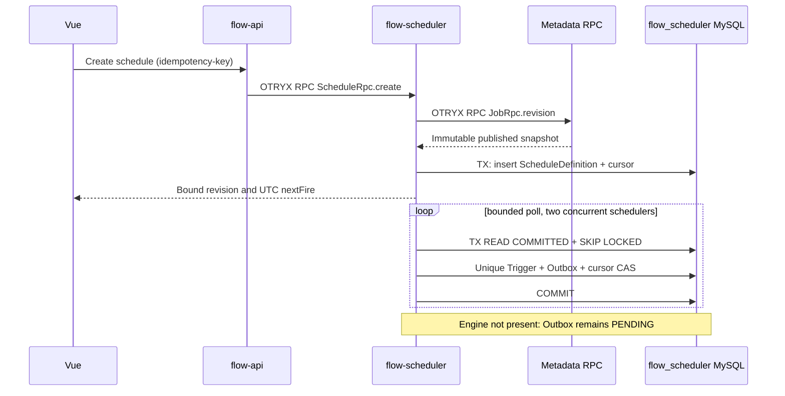

# M2 FLOW-010：分布式 Scheduler 实现说明

> Current on #5 PR candidate. **仅提交计划触发与待交付 Outbox；Engine、Dispatcher、Worker 尚未开发，绝不展示虚构执行状态**。当前 Compose `TRUSTED_DEVELOPMENT`、Etcd 明文仅限隔离研发；严禁公网暴露。

## 服务边界

- `flow-scheduler` 单独运行（Compose 两副本），自行拥有 `flow_scheduler` 数据库和 Flyway 迁移，不对 Metadata DB 进行 SQL 读写。
- `flow-api` 使用 OTRYX RPC `ScheduleRpc` 创建、暂停、查询和查看 Trigger。Spring Security 的项目管理权限检查在 REST 入口执行，Scheduler 通过已登录用户名、项目 ID，**RPC 查询 Metadata 的不可变 JobRevision** 验证该用户确实有权访问该项目且任务已发布。
- `flow-scheduler-core` 沿用 #4 同一个 Spring 六字段 Cron/IANA TZ 解析核心，所有真实 fire 时间为 UTC Instant。DST 缺时跳过；重复本地时刻仅使用早偏移。

## 唯一性与持久语义

一个 Cron 火点的唯一键是 `(schedule_id, schedule_revision, planned_fire_at_utc, origin)`，事件 ID 由上述四元组稳定派生。`flow_schedule_outbox` 在与 `flow_schedule_trigger` 相同的本地 MySQL 事务内写入，游标更新完成后才提交。未创建 Engine 消费者之前，Trigger 状态 `PENDING_ENGINE`、Outbox 状态 `PENDING`，**不计作运行成功**。

两个或更多 Scheduler 副本使用数据库行锁领取有限计划：`READ COMMITTED` + `SELECT ... FOR UPDATE SKIP LOCKED`；单轮最多领取 12 条 Schedule，每条最多产生 8 个 Cron 火点，事务最长 10 秒，不在事务内进行 RPC。唯一索引与 cursor 版本条件更新为独立第二道防重保护。

数据库连接强制 UTC Session 时区；Scheduler 使用 MySQL `UTC_TIMESTAMP(3)` 作为统一扫描时钟。任务列表和查询结果由业务 RPC 固定长度（100 条）返回。

## Misfire 策略与限制

| 策略 | 行为 | 边界 |
| --- | --- | --- |
| `SKIP` | 火点迟到超过 30 秒，不产生执行火点，游标跳到当前 UTC 之后 | 当前未单独持久化跳过审计事件；后续完善 |
| `FIRE_ONCE` | 超过 30 秒时将最旧的待处理火点合并为一个逻辑 Fire，游标跳到当前 UTC 之后 | 需要 Engine 保留合并语义，后续增强 |
| `CATCH_UP` | 最长回溯 1 小时，每次最多生成 8 个旧火点 | 旧窗口外跳过；后续审计强化 |

暂停使用 DB 版本 CAS，不关闭其他同项目任务。重新启用时从**当前**时间计算新的第一个 UTC 火点，不盲目恢复暂停期间所有过期点。Cron 绑定已经发布的 JobRevision，不能随草稿编辑漂移。

## 恢复与风险

- Scanner 在事务内崩溃：游标、Trigger、Outbox 要么全部回滚，要么全部提交。副本下一次领取时可以继续处理。
- 事务已经提交但 Engine 未启动：Outbox 永久保留 `PENDING`，#6 的 Engine/Outbox Relay 将以事件 ID 幂等交付，保证后续可恢复。
- Metadata 不可用：新的 Schedule 创建失败（REST 503），不能绕过项目归属权限检查；已经持久化的 Schedule 可以继续调度。
- MySQL 不可用：本轮扫描失败并记录英文日志；后续恢复后按有限 Misfire 窗口处理。
- 生产安全：当前开发 Compose 的匿名明文 Etcd/OTRYX RPC **不是** `NETWORK_MTLS`；生产要独立部署受保护 Etcd、RPC 双向 TLS、授权器和密钥。

## 验收

- JUnit：Misfire 边界、DST、幂等 Create、版本 CAS、权限、双 Scanner 竞争与 Outbox 数量。
- 真实 Compose：两个 Scheduler 实例、Etcd/OTRYX RPC 发布版本验证、可查询的唯一 Trigger 与对应 Outbox、其中一个副本重启后继续触发、启停 CAS。
- 合并条件：准确 PR Head 的 `backend/source/frontend/docs/compose-integration` 全绿。请勿把成功编译当成真实业务执行。
