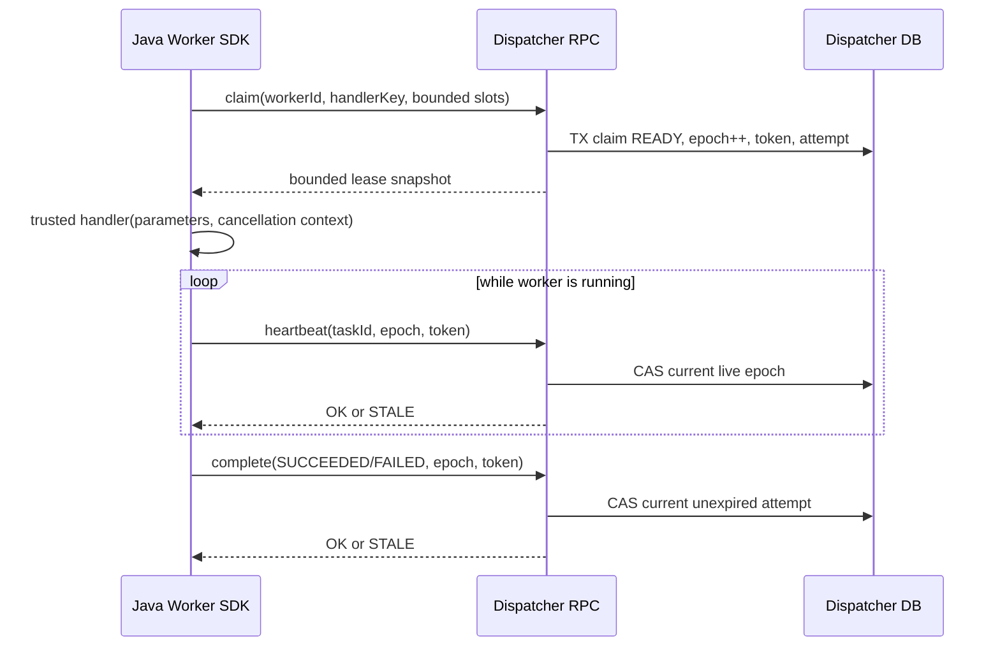

# FLOW-013：可信 Java Worker SDK 与 Nacos Quickstart

> Issue #8 实现候选。只有最新 PR Head 完成 Java/前端/真实 Nacos Compose 验证才算交付。Dispatcher 已合并（PR #14），本 Issue 新增真正执行 Java Handler 的独立 Worker 进程；Engine 最终状态回传与 DAG 完整协调属于 Issue #9。

## 服务边界与组件

`flow-worker-sdk` 是可嵌入任意受信任 Java 进程的纯 Java Library；只依赖 Dispatcher RPC 契约，不操纵 Dispatcher 数据库。`flow-worker-quickstart` 是独立 Spring Boot JVM 示例，使用唯一 `otryx-spring-boot-starter` 与 `otryx-registry-nacos`，以 **Consumer 应用级**方式发现 Dispatcher。部署者在启动时显式注册 `safe.echo` 等可信 Handler，绝不从 JSON、用户输入或 Config 动态实例化 Java 类。

## 资源和状态不变量

- Worker ID 为 3–64 字符；最多预注册 16 个 Handler，handlerKey 必须匹配明确格式，不能反射/动态执行脚本或外部输入驱动代码。
- `maxConcurrent` 为 **1–8**，Executor 与 Semaphore 共同约束同进程并行 Handler。领取前预留槽位；成功提交 Handler 后只有真实 Handler 退出才释放槽位，防止取消后无界重复领取。
- 每次只按一个 `handlerKey` 领取，`claim.limit <= maxConcurrent`，租约 snapshot 仅在进程内保留；日志不会输出 `leaseToken`。
- 续期与终态提交始终传入 `workerId + taskId + leaseEpoch + leaseToken`，由 Dispatcher 数据库按未到期租约做 CAS。**旧 Worker 的回执不能覆盖新代际。**
- Worker 对暂时不可用的心跳只记录未知结果，不宣称已续租；超时与 STALE 触发协作取消/线程中断。`close()` 先停止领取，再限时等待在途任务，超时请求取消。
- Handler 必须处理 `InterruptedException` 或定期调用 `WorkerContext.checkCancelled()`；Java 不可能可靠强杀无合作线程，外部副作用**仅保证至少一次尝试**，不提供 Exactly Once。
- `complete` RPC 超时不表示远端没提交成功，不能以本地日志覆盖数据库真相；后续租约过期和 Fencing 处理未知结果。

## 使用方式

1. 在 Java 21 项目中引入 `flow-worker-sdk` 与 OTRYX RPC Starter/对应 Nacos Adapter；不要直接引用 Dispatcher 实现模块。
2. 注入 `DispatcherRpc`；用不可变 `Map<String,WorkerHandler>` 注册可信 Handler，使用 `WorkerSettings.development(workerId)` 起步。
3. 在 ApplicationReady 后构建 `WorkerRuntime` 并调用 `start()`；退出时用 `close()`。真实例子见 [`flow-worker-quickstart`](../../flow-worker-quickstart/README.md)。
4. 从受控 CI 运行 `bash scripts/test_m2_worker_e2e.sh`，验证实际 Nacos Consumer → Dispatcher RPC → `SUCCEEDED` Attempt。此脚本会创建任务并停止测试 Worker，不适用于生产。

## 安全与未完成事项

- 现有 OTRYX RPC Nacos Adapter 仍为 `TRUSTED_DEVELOPMENT`，不支持完整 `NETWORK_MTLS`。服务标识只是声明，不能当作认证身份；正式上线须绑定 mTLS 和 Worker workload identity。
- 示例 `safe.echo` 不访问互联网、不读文件/密钥、不执行 Shell，只证明 Worker 流程正确。任意 Python/Jar/Shell 动态执行均不是支持的 Handler。
- Engine 对 Dispatcher 的终态回传、复杂 DAG 节点推进、重试结果快照、终态审计属于 Issue #9。此阶段前端 `DISPATCHED` 不应标为完整执行成功。
