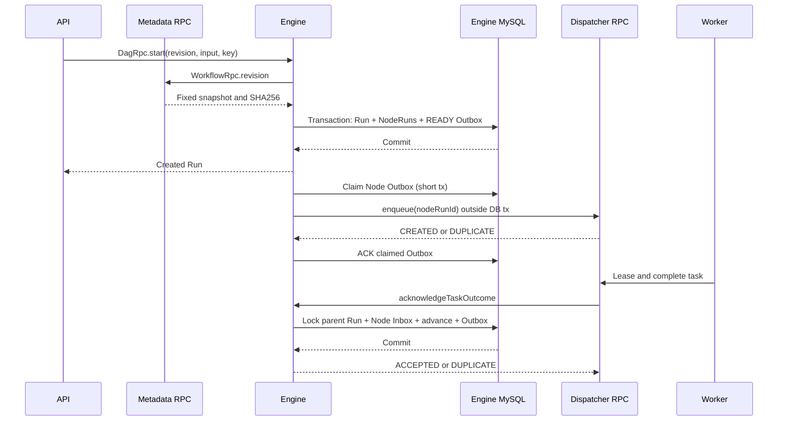

# FLOW-016 / M3：Engine DAG 节点执行与可靠终态

**状态：PR #22 待验收。** 已在 main 的 FLOW-015 提供不可变工作流版本及 DAG 校验。完整 DAG Runtime 必须通过真实 Compose 验收后才能确认。

## 服务与事务边界

Metadata 通过 `WorkflowRpc.revision` 返回项目受限的不可变图及 SHA-256；Engine 在事务外获取固定快照，校验哈希后才允许创建 Run。Engine 拥有 `flow_dag_run`、`flow_dag_node_run`、`flow_dag_dispatch_outbox`、`flow_dag_outcome_inbox`，不得直接写入 Metadata 或 Dispatcher 数据库。

原有 M2 的 `UNIQUE(engine_run_id)` 只支持一个执行单元，因此 DAG 的**每个 NodeRun ID**作为 Dispatcher 的唯一执行键，父 WorkflowRun ID 独立持久化，既可让一个 Run 对应多个节点，又保留 M2 单任务兼容性。Dispatcher 的 scheduleId 和 jobId 列临时映射 DAG Run ID 与 WorkflowDefinition ID，后续升级应有独立的节点任务 DTO。

## 一致性推进

- A→(B∥C)→D：D 只能在 B/C 持久完成后入队；并行分支就绪同时发生。
- 条件节点仅计算受限 AST，基于创建 Run 时的不可变输入；未选择的下游变为 SKIPPED，节点汇聚等待所有父节点终态。
- fail-fast：FAILED 后不再新增 READY，已有执行中的兄弟节点仍可报告真实结果；取消与人工重试归 FLOW-017。
- 默认一次最多 8 个活跃任务节点，最多 100 节点/500 边/32 拓扑深度。NodeRun 与首次 READY Outbox、终态 Inbox 与后继 READY Outbox 均为单个本地事务。
- Outbox 用 SKIP LOCKED、租约 Token、过期回收与有界退避重投。Worker 终态按 eventId/payload SHA-256 去重，禁止同节点被不同终态覆盖。
- 经多次重试仍不成功时将派发事件隔离为 DEAD，并使父 Run 进入 FAILED。

## 非目标与验收

生产 mTLS、任意脚本执行、Vue Flow 可编辑画布、人工取消重试，以及性能和公网发布均不在本 PR 范围。依靠[RPC/REST 契约](../04-api/m3-dag-runtime-contracts.md)与[真实验收](../06-testing/m3-dag-acceptance.md)形成证据。

