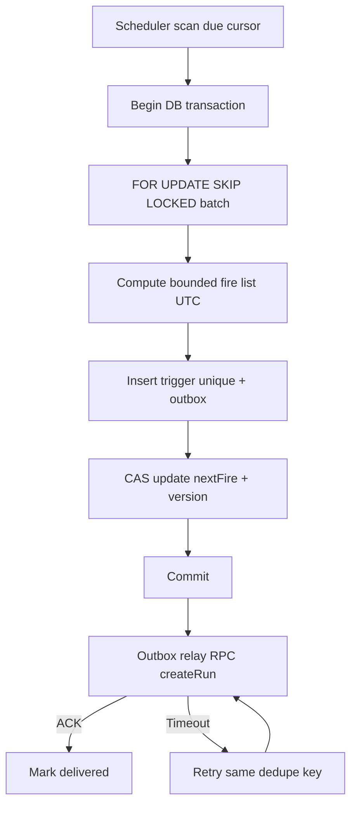

# Scheduler 详细设计（Proposed）

## 目标与职责
Scheduler 负责将已发布的 `ScheduleDefinition` 转化为精确、可去重、可回溯的计划火点，不负责执行 Handler、不直接更新 WorkflowRun 终态。触发支持 Cron、指定时刻、手动；所有计划时间持久化为 UTC，时区由 IANA TZ ID 表示。

## 数据与唯一性
- `schedule_definition`：`id`、`project_id`、`revision`、`cron_expr`、`time_zone`、`misfire_policy`、`concurrency_policy`、`enabled`、`next_fire_at_utc`、`version`。
- `schedule_trigger`：`id`、`schedule_id`、`revision`、`planned_fire_at_utc`、`origin`、`dedupe_key`、`status`、`created_at`；唯一 `(schedule_id, revision, planned_fire_at_utc, origin)`（手动触发另用请求幂等键）。
- `outbox_event`：与 Trigger 同事务写入，待交付给 Engine；不能直接把 RPC 回执当成唯一状态保存手段。

## 时序与并发算法

具体实现要点：
1. 使用 SQL `READ COMMITTED` 的队列扫描交易并验证隔离行为；`SKIP LOCKED` 只用于冲突批次领取，不用于普通业务列表读取。每笔交易有固定批次和超时，不在事务中调用 RPC。
2. 规划周期按数据库时间基准取当前时间以减小多节点时钟偏差；所有节点做 NTP 偏差监控。Cron 表达式通过固定解析器版本和明确 TZ/DST 策略生成 UTC fire。
3. 插入火点用 DB 唯一约束；失败后可安全从 Cursor 继续扫描，不能跳过已经决定但未持久化的 Trigger。
4. `misfire` 的 `SKIP/FIRE_ONCE/CATCH_UP` 行为按 [功能细则](../01-product/functional-spec.md) 执行；CATCH_UP 必须受窗口/数量限制。
5. 手动触发并不修改 Cron cursor。请求幂等键按 `(project, caller, idempotency_key)` 限时存储并映射到 Run。

## 并发策略
`ALLOW` 受项目级活跃额度约束；`FORBID` 若活动 Run 存在则记录跳过事件，不能仅靠无锁的内存计数；`QUEUE` 使用持久队列排队并限制积压/过期。准确实现需要 Engine 已确认的 Run 状态快照与并发预留 token；控制面通信失败时不放大并发（Fail Closed）。

## 故障恢复
- Outbox 未确认：以原 `dedupe_key` 重投，不创建新的逻辑 Fire。
- 部分批次触发写入失败：整个事务回滚或按唯一 Fire 去重安全重试。
- Scheduler 节点崩溃：另一节点扫描到期 cursor；租约/队列表锁释放后接管。
- 停机很久：按 `misfire_policy` 有限补触发，不无限循环追赶。
- 数据库不可用：停止创建新 Trigger 并告警，不伪造成功。

## 验收要点
两个 Scheduler 并发处理相同计划窗口仅产生唯一逻辑 Trigger；恢复窗口、DST、Cron 修改后 Revision、数据库超时和重复 Outbox 都必须有并发/故障测试（AT-04、AT-07、AT-09）。
