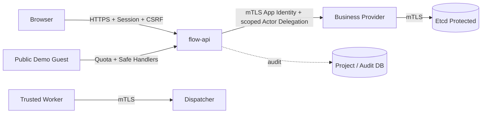

# 身份、鉴权和任务安全设计（Proposed）

## 1. 信任边界

## 2. 用户身份
V1 使用 Spring Security、服务端项目 RBAC 和单实例 HTTP Session。浏览器使用 HttpOnly/SameSite Cookie，状态修改请求校验 CSRF。在引入第二个 API 副本之前，不把本机会话说成高可用；共享会话存储留到那时再选。

## 3. 服务身份与授权
- Provider 依据 OTRYX RPC `NETWORK_MTLS` 的实际 Peer 证书绑定校验调用方应用，而不是信任 RPC Metadata 的用户 ID。
- 在应用身份认证之后，校验被调用的方法授权及必要的用户委托。用户委托内容需要签名、过期、受众、项目范围，且不能拓宽 Flow API 已授予的范围。
- 内部 Worker 身份关联 `workerId` 和 allowlisted Handler，不能自行伪造别的工作组的容量；Dispatcher 校验 Worker 对任务 Group 的接入权限。
- 注册中心是 Nacos 3.2.4，不再把 Etcd 加回当前部署。Naming/Config/login 的 TLS 与 `NETWORK_MTLS` 仍被 OTRYX RPC #179 挡住。进程若被配置成该 Profile，启动失败，不回退到开发信任。

## 4. 自定义 Handler 安全边界
任务 Handler 标识必须匹配 `safe.*`。参数中的 URL、路径穿越和进程执行字样在 REST 层拒绝。工作流条件仍只做 JSON 比较。这不是生产 mTLS，也不代替独立沙箱。

## 5. 密钥、审计、脱敏
证书/DB 密码/API Secret 通过部署环境秘密管理传入，不存仓库或样例数据；操作人、来源、受影响项目、请求 ID、操作类型、结果和时间进入不可覆写审计。日志字段白名单，错误返回不给暴露 stack trace/内网地址/数据库连接信息。

## 6. 测试
未授权调用、旧/假证书、跨命名空间应用、过期签名、重放请求、越权项目访问、Webhook SSRF 防护（如引入）、危险任务类型的禁用必须有自动测试。源契约参考 [OTRYX 安全指南](https://github.com/Ryan-Guizhou/otryx-rpc/blob/main/docs/security.md)。
