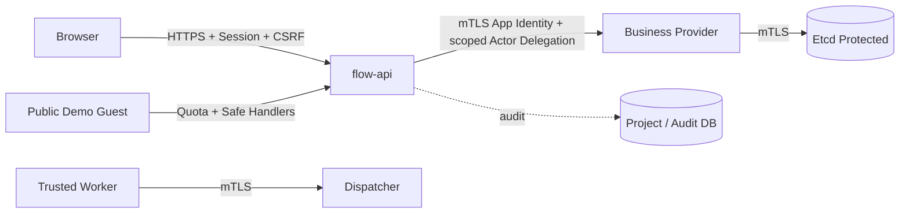

# 身份、鉴权和任务安全设计（Proposed）

## 1. 信任边界

## 2. 用户身份
V1 拟议 Spring Security + 服务端项目 RBAC，账号凭证安全哈希；浏览器使用 Secure/HttpOnly/SameSite Cookie、状态修改请求 CSRF 防护、登录失败限速。多实例 API 会话如需共享则引入具保护的会话存储（例如 Redis），或选择等效经审计的统一身份入口；不能依赖某实例本地 Session 而宣称无状态高可用。

## 3. 服务身份与授权
- Provider 依据 OTRYX RPC `NETWORK_MTLS` 的实际 Peer 证书绑定校验调用方应用，而不是信任 RPC Metadata 的用户 ID。
- 在应用身份认证之后，校验被调用的方法授权及必要的用户委托。用户委托内容需要签名、过期、受众、项目范围，且不能拓宽 Flow API 已授予的范围。
- 内部 Worker 身份关联 `workerId` 和 allowlisted Handler，不能自行伪造别的工作组的容量；Dispatcher 校验 Worker 对任务 Group 的接入权限。
- OTRYX Registry 控制面使用受保护 Etcd，测试实际 TLS/RBAC。Nacos 的当前网络 Profile 安全能力不足，不能用于公网 Demo 生产基线。

## 4. 自定义 Handler 安全边界
M1-M6 仅运行部署方审核过的 Java Handler；拒绝任意 ClassName、上传 Jar、执行 Shell、无限制 HTTP URL 和动态脚本表达式。Workflows 中条件仅白名单 JSON 比较，不做表达式运行时代码执行。未来运行非可信代码必须做独立沙箱/容器和资源/网络限额安全审查。

## 5. 密钥、审计、脱敏
证书/DB 密码/API Secret 通过部署环境秘密管理传入，不存仓库或样例数据；操作人、来源、受影响项目、请求 ID、操作类型、结果和时间进入不可覆写审计。日志字段白名单，错误返回不给暴露 stack trace/内网地址/数据库连接信息。

## 6. 测试
未授权调用、旧/假证书、跨命名空间应用、过期签名、重放请求、越权项目访问、Webhook SSRF 防护（如引入）、危险任务类型的禁用必须有自动测试。源契约参考 [OTRYX 安全指南](https://github.com/Ryan-Guizhou/otryx-rpc/blob/main/docs/security.md)。
