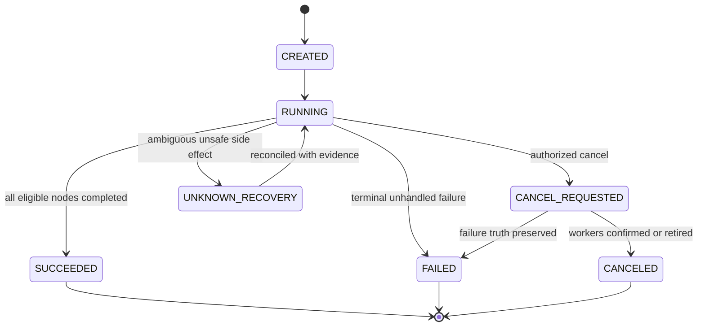

# Workflow Engine 详细设计（Proposed）

## 1. 模型
`WorkflowRevision` 为不可变 DAG：包含 `nodeId`、`handlerKey`、参数 Schema、依赖边、条件表达式、失败策略和资源要求。`WorkflowRun` 固定引用 `workflowRevisionId`、`triggerKey` 和创建时输入快照。`NodeRun` 表示节点逻辑生命周期；`TaskAttempt` 由 Dispatcher 拥有，不在 Engine 复制 Worker Lease。

## 2. DAG 校验和发布
- 每个 `nodeId` 在版本内唯一；每条依赖只引用存在的节点；拒绝自环和拓扑排序无法覆盖所有节点的图。
- 要求至少一个入口与出口，版本大小、节点/边数量、参数大小和最大拓扑深度有界。
- 条件表达式是**受限的 JSON 字段比较**及 AND/OR，无动态脚本、反射或 SQL；在后端与前端分别验证，并在后端做最终决定。
- 发布时创建不可变 revision（规范化 JSON + 内容哈希）。一旦运行，即使另一个版本上线，原实例仍按已保存的 revision 进行确定性恢复。

## 3. 运行状态机

## 4. 节点推进
1. Engine 收到 `createRun(triggerKey, revisionId)`：业务幂等键去重，写 `workflow_run + node_run initial state + outbox` 同一事务。
2. 入度为零的节点就绪；对受条件约束的节点计算安全表达式；未选中的分支变 `SKIPPED`。
3. 每个 Ready 节点创建唯一 `dispatchKey=(workflowRunId,nodeId,logicalAttempt)`，以 Outbox 异步投递 Dispatcher。
4. Dispatcher 返回 `accepted/duplicate` 只是确认创建了任务记录；Engine 不能据此标记节点成功。
5. Engine 通过 `TaskOutcomeSink` 接受 Dispatcher 的终态事件，按 `eventId` + `nodeRunVersion` 幂等，事务内改变节点并判断新的 Ready 集。
6. 一个 Node 的终态只能按合法状态跃迁；迟到的旧 Outcome 不覆盖新 Attempt 的最新状态。
7. 默认 `FAIL_FAST`：阻止尚未开始的下游；向已运行的兄弟节点发送取消请求；最终输出必须如实反映已完成、无法取消和失败状态。

## 5. 并行与竞态
多个 Dispatcher 结果同到：同一个 `workflow_run` 的推进用数据库版本 CAS 或行锁串行提交，幂等入队键避免并行两次派发一个节点。活动节点数量设置项目级硬限制，队列超限明确进入受控等待/拒绝态而非无界增长。

## 6. 恢复和版本兼容
引擎启动后扫描 `workflow_run` 中非终态实例，与 Dispatcher 按 `taskId/dispatchKey` 对账。无法确认副作用的节点标记人工复核而非自动假定失败。Revision schema 改变需要有序向前/向后迁移；滚动部署的旧 Engine 必须仍可读取运行中的旧 Revision。

## 7. 验收
A→(B||C)→D 并行依赖、分支 SKIPPED、周期重试、FAIL_FAST、运行中切版本、多个结果并发到达、重复事件与服务崩溃恢复（AT-05、AT-06、AT-09、AT-10）。
