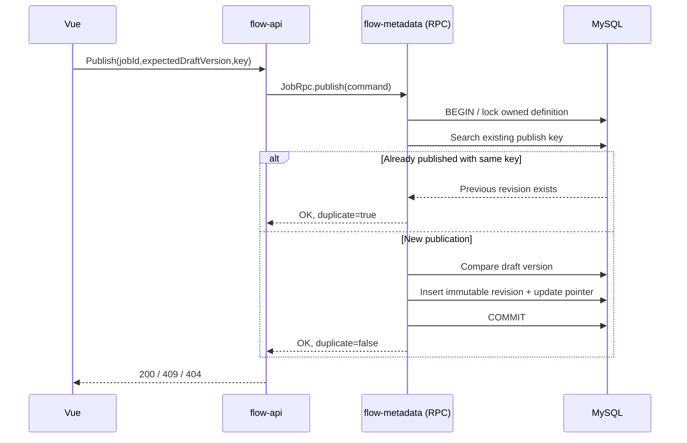

# M2 JobDefinition REST / RPC contracts (FLOW-008)

Status: **implementation candidate**. This document covers concrete Java sources added for Issue #3, not a completed Scheduler, Engine or Worker. Acceptance evidence must refer to the exact PR commit and integration workflow.

## State and ownership

- One `flow_job_definition` belongs to an existing `flow_project` and its authenticated owner. `ownerUsername` is supplied by the API service from the server-side session; browsers cannot override it.
- Draft fields are mutable only through optimistic `expectedDraftVersion`, which must equal the persisted version. Concurrent writes at the same draft version cannot both succeed.
- Published revisions in `flow_job_revision` are immutable snapshots of `name`, trusted `handlerKey`, JSON object parameters, timeout, attempts and source draft version.
- The first draft starts with `draftVersion=1`, `publishedRevision=0`. Publish creates revision 1. Editing bumps the draft version; publishing again creates revision 2. Existing revision 1 is never rewritten.
- The same creation key `(ownerUsername,createRequestKey)` is unique; the same key with a different payload returns 409 without creating another definition. The same publish key `(jobId,publishRequestKey)` never creates a second revision.
- The REST API returns 404 on missing/foreign job IDs, 409 on stale draft versions or changed idempotency payload, and 400 on malformed UUID/request key. Auth, session and CSRF follow M1 policy.
- Worker execution is **not** part of FLOW-008. A published Handler key is an identifier, not permission to evaluate untrusted class names or scripts.

## RPC interface

Provider `flow-metadata`: `com.peachsoft.otryx.flow.contracts.v1.JobRpc`, version `1.0.0`. The API injects `@OtryxRpcReference`; the provider registers `@OtryxRpcService`. No HTTP-to-HTTP fallback is permitted.

| Method | Request | Result | Retry contract |
|---|---|---|---|
| `list(owner,project)` | authenticated principal + owned project UUID | `JobListReply` max 100 | read-only, safe |
| `createDraft(command)` | project, owner, stable key, name, handler and bounded JSON | `JobMutationReply` | idempotent by unique key+fingerprint |
| `saveDraft(command)` | expectedDraftVersion + new fields | `JobMutationReply` | optimistic CAS; **not** transparent retry |
| `publish(command)` | expectedDraftVersion + stable publish key | `JobMutationReply` | idempotent by unique key |
| `revision(owner,project,job,number)` | published revision number | `JobRevisionView` | read-only, safe |

## REST paths

| Verb | Path | Role |
|---|---|---|
| GET | `/api/v1/projects/{projectId}/jobs` | signed-in owner |
| POST | `/api/v1/projects/{projectId}/jobs` | ADMIN, CSRF, Idempotency-Key |
| PUT | `/api/v1/projects/{projectId}/jobs/{jobId}/draft` | ADMIN, CSRF, expectedDraftVersion |
| POST | `/api/v1/projects/{projectId}/jobs/{jobId}/publish` | ADMIN, CSRF, Idempotency-Key, expectedDraftVersion |
| GET | `/api/v1/projects/{projectId}/jobs/{jobId}/revisions/{revision}` | signed-in owner |

Input bounds: name <=100 characters; handler key `[a-z][a-z0-9_.-]{2,127}`; JSON **object** <=16 KiB encoded UTF-8; timeout 1..86400 seconds; retry attempts 1..10. Storing a Handler key never means the server will execute arbitrary code.

## Publication sequence

## Failure boundaries

A lost RPC response does not imply the write failed. For creation or publication, the client must reuse the same request key until it can reconcile the result. A stale draft update requires refreshing the current version, not blind retry. Do not add RPC-side automatic retries to `saveDraft`.

## Planned next milestone

FLOW-009 adds Cron schedules and timezone preview. FLOW-010 and later implement durable fire points, Outbox, Engine, Dispatcher and Worker. Neither a published revision nor a UI status badge is proof of task execution.
