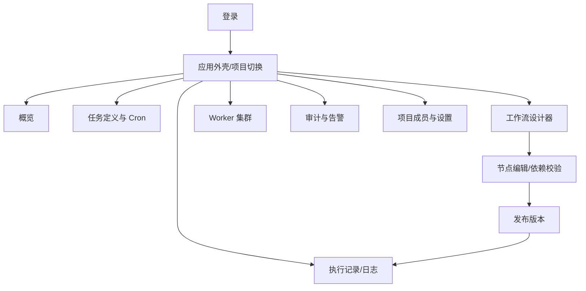

# 前端 UI/UX 规格（Proposed）

## 技术与交互方向
Vue 3 + TypeScript + Vite + Element Plus + Vue Flow + ECharts；路由、状态管理、表单验证、OpenAPI 生成客户端与 i18n 模块按源码版本固定。桌面优先，最小可用宽度需在 M1 UI 评审确定；终端监控页面适配窄屏只读模式。

## 信息架构

## 交互原则
1. **编辑与运行分离**：工作流画布草稿可以撤销/重做，发布前由服务端校验；运行详情始终是执行版本快照，不自动显示编辑中的新图。
2. **异步命令可追踪**：发起 Run 返回“已受理+runId”，由轮询/受控 SSE 追踪真实执行状态，不显示假成功。
3. **取消是意图不是事实**：点击取消后显示 `CANCEL_REQUESTED`，直到收到权威事件才改成 CANCELED/TIMED_OUT/SUCCEEDED。
4. **时区清晰**：列表提供站点偏好时区与 UTC 对照；Cron 预览带夏令时说明，显示绝对 UTC 时间。
5. **可恢复操作**：列表支持过滤/分页，表单保留未提交内容；乐观锁 409 弹出版本冲突，不静默覆盖别人的修改。
6. **权限一致**：按钮隐藏只是 UX，服务端必须校验项目 RBAC；Demo 访客仅能运行 `safe-demo-*` 内置任务。

## 设计系统
- 8px spacing 基础、文字/按钮状态一贯；成功、失败、警告状态不只靠颜色表达，配合图标和文本。
- 不将敏感内部错误堆栈直接渲染在公开站点；提供可复制的 `requestId` 和脱敏日志。
- 支持键盘导航、可见焦点、表单 label、屏幕阅读器描述；目标 WCAG 2.2 AA（验收按具体页面交互测试）。
- 中英双语接口保留，日期、数字、时区和错误文案使用统一格式化层。

## 前端工程质量
至少需要 TypeScript typecheck、lint、Vitest、Playwright E2E、API Mock 契约测试；关键画布逻辑（环检测、拖拽取消、Revision 冲突）必须覆盖。截图不能代替功能或可访问性验收。
